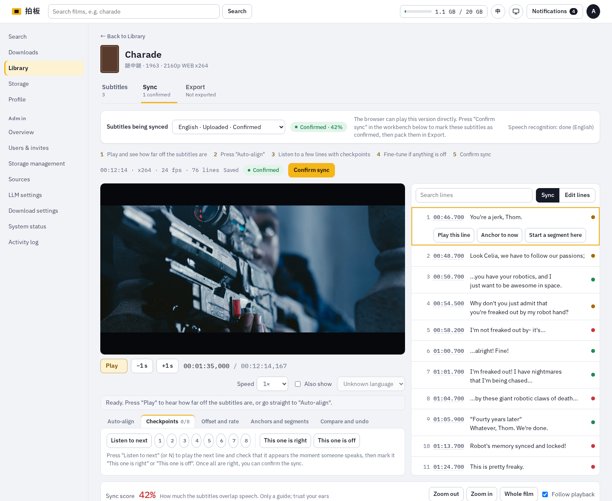
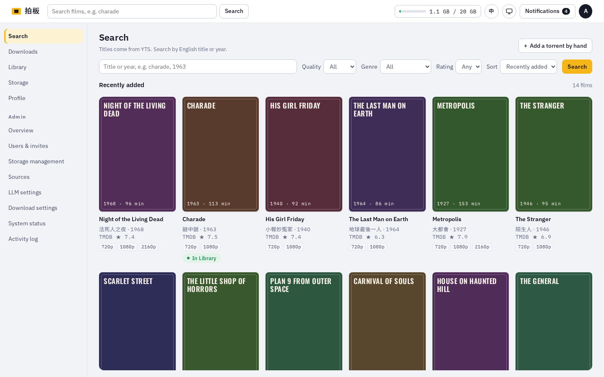
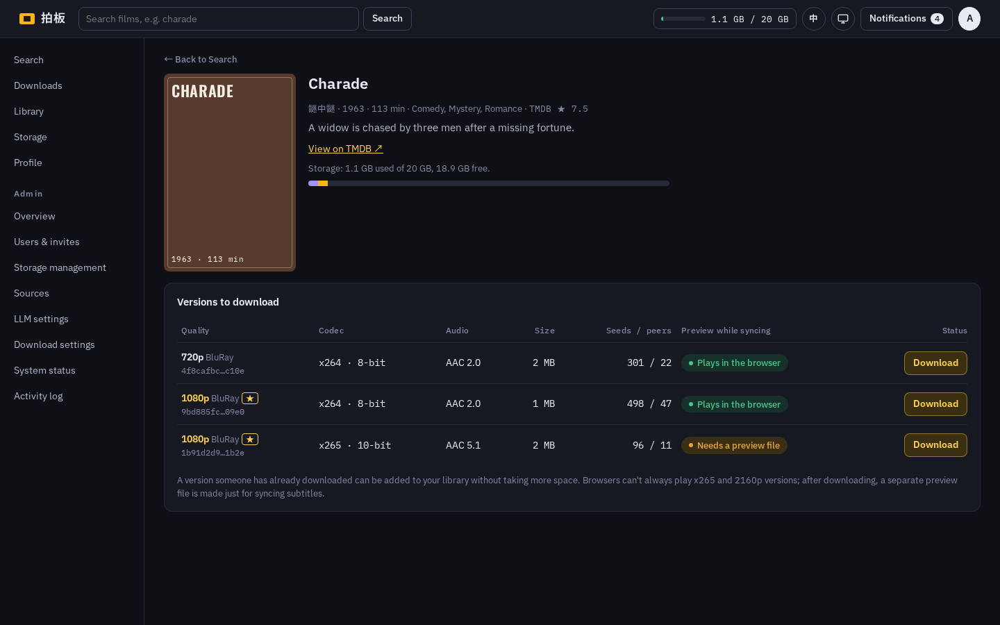
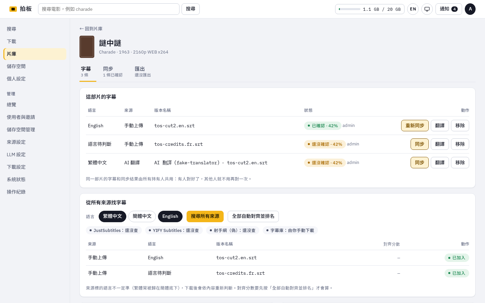
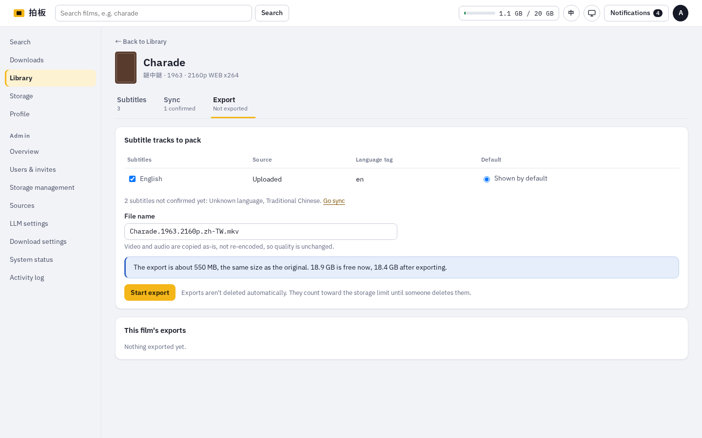
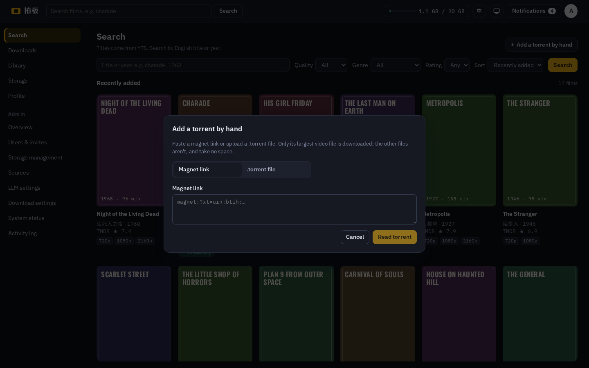

# Paiban

**A self-hosted film night kit: find a film, download it, get subtitles that actually line up, and take home an MKV.**

*Paiban* (拍板) is the clapperboard: the snap at the start of a take that lines sound up with picture. That is the part this project cares most about. Downloading a film is easy; finding subtitles that match *your* copy of it, to the frame, is not. Paiban gives you a browser workbench for it, with waveforms, speech detection and auto-align, then packs the film and the subtitles you confirmed into one MKV, losslessly.

The interface speaks Traditional Chinese (Taiwan) and English, each person's choice. It runs on your own machine with Docker Compose, for you and the people you invite.



## Features

**Find and download**
- Search YTS by title, year, quality, genre and rating. Chinese titles, posters and ratings come from TMDB, and typing a Chinese title suggests the film while you type.
- A built-in BitTorrent client (WebTorrent) with a queue, per-person and site-wide limits, speed limits, seeding rules, and a live view of peers, pieces and speed.
- Add a torrent by hand when YTS doesn't have the film: paste a magnet link or drop a `.torrent` file, pick the film on TMDB, and only the largest video file (plus the subtitles beside it) is downloaded.
- One copy per film, shared: everyone sees every film on the site and can add it to their library without taking more space.

**Subtitles**
- One search across JustSubtitles (SubDL), YIFY Subtitles and Assrt, plus your own uploads (`.srt`, `.ass`, `.ssa`, `.vtt` and archives). Subtitles that come inside the torrent, as files or as text tracks in the video, are added automatically.
- Encoding detection (Big5, GB18030, UTF-16…), language detection, and Simplified → Traditional conversion with Taiwan vocabulary.
- Rank every candidate by how well it lines up with the speech in the film.
- Translate subtitles into any language with a language model of your choice (OpenAI, Anthropic, Azure, OpenRouter, Ollama or any OpenAI-compatible server), in chunks with context, as translation only or bilingual.

**The sync workbench**
- The film (or a frame-exact preview when the browser can't play its codec), its waveform and detected speech, and the subtitle list, side by side.
- Auto-align with ffsubsync, speech recognition (faster-whisper) and, across languages, a language model that pairs what was heard with what was written. Or align by another subtitle already in sync.
- Offset and rate, anchors and segments (for cut scenes or a different frame rate), line edits, and checkpoints: listen to a few lines, mark them right or off, then confirm.
- Undo, compare with the original, and a sync score. Two people editing at once don't overwrite each other.

**Export**
- Pack the video, its audio and any confirmed subtitles into one MKV: copied as-is, never re-encoded. Track titles and language tags are set, and the default track is chosen.

**For a household**
- Invites, administrators and members, per-person preferences (interface language, poster country, subtitle languages).
- A storage limit with clear numbers, and nothing is ever deleted automatically.
- An activity log, a system status page, and notifications for finished downloads, exports and failures.
- The page loads nothing from other domains; posters and everything else go through your server.

## Screenshots

| | |
| --- | --- |
|  |  |
| Search, with Chinese titles from TMDB | A film's versions: size, seeds, and whether the browser can play it |
|  |  |
| The subtitles of a film, in the Chinese interface | Exporting an MKV |
|  | |
| Adding a torrent by hand | |

The posters in the screenshots are the typographic one-sheets Paiban draws when a film has no poster; with a TMDB key you see the real ones.

## Quick start

You need an x86-64 Linux machine with Docker and Compose v2, 4 GB of memory or more, and enough disk for your films.

```bash
git clone https://github.com/brianshen0522/paiban.git
cd paiban
cp deploy/.env.example deploy/.env
openssl rand -hex 24      # paste into POSTGRES_PASSWORD
openssl rand -base64 32   # paste into SECRET_KEY
# edit deploy/.env: PUBLIC_URL, BOOTSTRAP_ADMIN_USERNAME, BOOTSTRAP_ADMIN_PASSWORD

mkdir -p deploy/data
docker compose -f deploy/docker-compose.yml build
docker compose -f deploy/docker-compose.yml up -d
```

Open `PUBLIC_URL`, sign in as the administrator from `.env`, change the password under Profile, then in the admin menu:

1. **Sources**: enter a YTS address that currently works and press Test.
2. **Sources**: a TMDB key (free) for Chinese titles, posters and the subtitle sources; an Assrt token for more Chinese subtitles.
3. **LLM settings** (optional): a language model for cross-language auto-align and translation.
4. **Users & invites**: send invite links to the people you share it with.

[docs/deploy.md](docs/deploy.md) covers every `.env` setting, ports, HTTPS, updates, backups and moving to another machine.

## How it works

Five containers:

| Container | What it does |
| --- | --- |
| `proxy` | Caddy: serves the web app, forwards `/api`, handles TLS |
| `api` | Node (Fastify): accounts, search, subtitles, sync documents, live events |
| `torrent` | Node with WebTorrent: makes downloads follow what people asked for |
| `media` | Node with ffmpeg, ffsubsync and faster-whisper: analysis, previews, alignment, export |
| `postgres` | PostgreSQL: the state, and the only way the three Node services talk to each other |

The web app is React with TypeScript. Films, previews, subtitles and exports live under one data folder. More in [docs/02-architecture.md](docs/02-architecture.md).

## Development

Node.js 24, pnpm 12 and Docker.

```bash
pnpm install
pnpm db:test          # the test database (port 55432), before running tests
pnpm test             # Vitest for every package
pnpm typecheck        # TypeScript, strict
pnpm lint             # Biome
pnpm dev              # everything locally, offline: fake YTS, fake subtitle sources, local seeding
                      # open http://localhost:5173, sign in as admin / paiban-dev-not-real
```

Automated tests never reach the network and never download copyrighted material: they use the synthetic clips in `fixtures/`, a fake YTS, fake subtitle sources and a BitTorrent seeder on 127.0.0.1. Tests that need ffmpeg run inside the image with `pnpm test:image`.

## Documentation

The project was built from a written spec, and the spec is kept current with the code.

| | |
| --- | --- |
| [docs/01-product.md](docs/01-product.md) | What it is, who it is for, the main flow, the glossary |
| [docs/00-decisions.md](docs/00-decisions.md) | Settled decisions and where they came from |
| [docs/02-architecture.md](docs/02-architecture.md) … [docs/18-llm.md](docs/18-llm.md) | Data model, API, downloader, subtitle sources, media pipeline, workbench, storage, pages, auth, settings, UI |
| [docs/changes.md](docs/changes.md) | Every change to the spec, and why |
| [docs/handover.md](docs/handover.md) | The handover pack the project started from, and the reading order |
| [AGENTS.md](AGENTS.md) | Working rules for coding agents on this repo |

## Legal note

Not legal advice. Most content on YTS isn't authorized by the rights holders, and BitTorrent uploads while it downloads; in most places this kind of use carries legal risk, borne by whoever hosts and uses it. Use it for films you have the right to download. Development and testing use only the synthetic fixtures in this repository and freely distributable films.

This product uses the TMDB API but is not endorsed or certified by TMDB.

## Credits

- The film in the workbench screenshot is [Tears of Steel](https://mango.blender.org/) © Blender Foundation, [CC BY 3.0](https://creativecommons.org/licenses/by/3.0/).
- Fonts bundled with the web app: IBM Plex Sans and Mono, Oswald, Noto Sans TC (SIL Open Font License).

## License

[MIT](LICENSE). The license covers this code only; it grants nothing about any film, subtitle or other content the software downloads.
