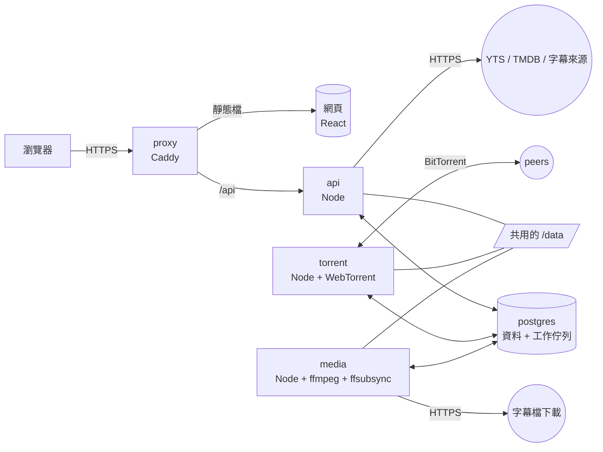

# 02 系統架構

## 全貌



五個容器，一台機器，一份 `docker-compose.yml`。

| 容器 | 做什麼 | 為什麼獨立 |
| --- | --- | --- |
| `proxy` | Caddy。提供網頁靜態檔、把 `/api` 轉給 `api`、處理 TLS | 靜態檔和 TLS 不該由應用程式負責 |
| `api` | 登入、所有 REST 端點、即時更新（SSE）、影片與匯出檔的串流、對外查詢 YTS / TMDB / 字幕來源。在容器內聽 3000 埠，只有 `proxy` 連得到 | 唯一對瀏覽器說話的程式 |
| `torrent` | WebTorrent 用戶端。依資料庫裡的狀態開始、暫停、移除下載，回報進度 | 網站更新重啟時下載不能中斷；它也是唯一對外開 BitTorrent 埠的容器 |
| `media` | 跑 ffmpeg 和 ffsubsync 的背景工作：分析、預覽檔、字幕下載與正規化、對齊、封裝 | 吃 CPU 的工作不能拖慢網站；映像檔裡的 ffmpeg 和 Python 只有它需要 |
| `postgres` | 所有資料，加上工作佇列（pg-boss） | 指定的資料庫；用它當佇列就不需要 Redis |

`api`、`torrent`、`media` 是**同一個映像檔**用不同指令啟動。這樣只要建置一次，共用的程式碼也不會版本不一致。

## 服務之間怎麼溝通

三個 Node 程式**彼此不直接呼叫**，只透過 PostgreSQL 和共用的 `/data`：

| 管道 | 用途 |
| --- | --- |
| 資料表 | 狀態的唯一來源。例如 `api` 把 `torrents.want` 設成 `pause`，`torrent` 看到後去執行，再把 `torrents.state` 改成 `paused` |
| pg-boss 佇列 | 一次性的工作：分析一部片、轉一份預覽檔、對齊一條字幕、封裝一個 MKV |
| `LISTEN` / `NOTIFY` | 叫醒對方，不帶資料。三個頻道：`paiban_torrent`（有下載要處理，`torrent` 在聽）、`paiban_media`（有影片或匯出的狀態要處理，`media` 在聽）、`paiban_events`（某筆資料變了，內容是 `{type, id}`，`api` 在聽，收到後查資料庫並推給瀏覽器；類型的清單在 [04-api.md](04-api.md) 的「即時更新」） |
| `/data` | 檔案本身 |

這樣設計的好處是任何一個程式重啟都不會遺失工作：狀態在資料庫裡，重啟後重新讀一次就接得上。

**資料表是真相，佇列只是叫人去做事的方法。** 具體來說：

- 要讓某件事發生，就把那一列寫成「等待中」（例如 `media_files.analysis_state = 'pending'`、`exports.state = 'queued'`），然後 `NOTIFY`。寫的人不需要知道佇列的存在；`torrent` 完全不碰 pg-boss。
- `media` 有一個**對帳**的步驟：啟動時、收到 `paiban_media` 時、以及每 60 秒，找出所有「等待中但佇列裡沒有對應工作」的列，替它們排入工作。同一列用它的 id 當作佇列的去重鍵，所以重複排入不會變成兩個工作。正在被刪除的片（`want = 'remove'`）跳過。對帳看哪些列、排入什麼，列在 [08-media-pipeline.md](08-media-pipeline.md) 的「對帳」。
- 每個工作的處理函式一開始先用帶條件的更新把那一列從「等待中」改成「進行中」。改不到（影響 0 列）就直接結束。所以就算同一件事被排了兩次，也只會做一次。
- 工作做完時，最後那一筆更新同樣帶條件。改不到就表示東西在它做的途中被刪了或被取消了：它把自己剛寫出來的檔案刪掉，然後結束（[03-data-model.md](03-data-model.md) 的「刪除一個下載時發生的事」）。

### 佇列

| 佇列 | 內容 | 誰處理 | 同時幾個 | `tasks` 的種類 |
| --- | --- | --- | --- | --- |
| `media.analyze` | 探測檔案、決定要不要預覽檔、波形、人聲偵測 | media | 1 | `analyze` |
| `media.preview` | 一部片的預覽資產：先做 `audio.m4a`，再做 `proxy.mp4` | media | 1 | `preview` |
| `export.mux` | 封裝 MKV | media | 1 | `export` |
| `subtitle.search` | 向一個來源查一部片的字幕 | api | 3 | |
| `subtitle.resolve` | 向來源問出一條候選字幕現在的下載網址 | api | 2 | |
| `subtitle.fetch` | 下載一條候選字幕、解壓縮、轉成 UTF-8 的句子清單 | media | 2 | |
| `subtitle.ingest` | 處理使用者上傳的檔案 | media | 2 | |
| `subtitle.align` | 使用者按下「自動對齊」：對齊一條已加入的字幕。有人在等 | media | 2 | `align` |
| `subtitle.rank` | 排名用：在背景對齊一條候選字幕 | media | 1 | `rank`（一次排名一列） |
| `storage.rescan` | 重新計算磁碟用量 | media | 1 | `rescan` |

幾個刻意的安排：

- **轉檔一次只跑一個。** `media.preview` 是最吃 CPU 的工作（一部片可能要幾十分鐘到幾小時），同時只做一部，避免在 NAS 上把 CPU 佔滿。
- **封裝有自己的位置。** `export.mux` 不重新編碼，幾乎只受磁碟速度限制，通常不到一分鐘。它不排在轉檔後面，使用者按下匯出不該等別的片轉完。
- **前景和背景的對齊分開。** `subtitle.align` 是有人按了按鈕在等的；`subtitle.rank` 是一次排三十條的背景工作。分成兩個佇列，前景才不會被背景塞住。
- **對外的查詢也是工作。** `subtitle.search` 和 `subtitle.resolve` 由 `api` 自己處理（只有它拿得到金鑰）。做成工作而不是在請求裡直接呼叫，是為了讓 `api` 重啟時不會留下永遠停在「查詢中」的來源。

`tasks` 資料表是給人看的：管理員的「系統狀態」頁讀它，失敗的可以從那裡重試。只有上表最右欄有寫的工作才有 `tasks` 的列；其餘的很短，它們的狀態已經在候選清單和來源狀態上看得到。pg-boss 自己的資料表不拿來顯示。

`tasks` 也是工作把結果交回給 `api` 的地方：`media` 把結果寫進 `tasks.result`、把 `state` 改成 `done`，然後 `NOTIFY paiban_events`（類型 `task`）；在等的那個請求收到通知後讀出結果。細節在 [08-media-pipeline.md](08-media-pipeline.md) 的「工作的共通規矩」。

## 磁碟配置

所有檔案都在一個掛載點 `/data` 底下，而且必須是**同一個檔案系統**（用量計算和搬移都假設如此）。

```
/data
├── torrents/<info_hash>/…          WebTorrent 下載的內容,維持 torrent 自己的目錄結構。只讀不改
├── media/<media_id>/
│   ├── probe.json                  ffprobe 的結果
│   ├── peaks.bin                   波形
│   ├── ref.npz                     ffsubsync 的人聲快取
│   ├── speech.json                 同一份人聲資料,給瀏覽器和對齊核心
│   ├── audio.m4a                   只有不能直接播的版本才有
│   └── proxy.mp4                   同上
├── subtitles/<subtitle_id>/
│   ├── original.<ext>              下載或上傳的原始檔,原封不動
│   ├── cues.json                   句子清單(UTF-8)。同步、顯示、匯出都用這一份
│   └── cues.original.json          只有加入時做過簡轉繁才有:轉換前的句子清單
├── subtitles/candidates/<candidate_id>/…   已抓下來但還沒加入的候選字幕:original.<ext> 和 cues.json
├── exports/<export_id>/
│   ├── <檔名>.mkv
│   └── tracks/<n>.srt              封裝期間暫存的字幕軌,封裝有了最後結果就刪掉
├── posters/<yts_id>.jpg            片庫裡的電影的海報快取(很小,不計入用量)
└── tmp/
    ├── uploads/<uuid>              使用者上傳的檔案,由 api 寫入,處理它的工作結束時刪掉
    └── work/<job_id>/              media 的工作目錄(解壓縮、對齊的暫存),工作結束時刪掉
```

`tmp/` 是工作過程的草稿，不算使用者的檔案：每個工作結束（不論成功失敗）就自己刪掉用過的東西，`media` 啟動時會清空 `tmp/work/`。這和「不自動刪除」的規則不衝突，見 [10-storage.md](10-storage.md)。

大的檔案（預覽影片、聲音檔、匯出檔）一律先寫成 `*.part`，完成後再改名。這樣任何時候看到正式檔名的檔案，它一定是完整的。`*.part` 只會出現在 `/data/media` 和 `/data/exports` 底下（以及 `tmp/`）；`/data/torrents` 是 WebTorrent 的地盤，我們的程式不在那裡寫檔，也不在那裡找 `*.part`。

字幕和候選的檔案很小，不用 `.part`：在 `tmp/work` 裡準備好，整個資料夾搬到 `/data/subtitles/…`（同一個檔案系統，搬移是一瞬間的事），然後才更新資料庫。

## 程式碼配置

pnpm monorepo。

```
paiban/
├── apps/
│   ├── web/                React 單頁應用
│   └── server/             Node。三個進入點:src/api.ts、src/torrent.ts、src/media.ts
├── packages/
│   └── shared/             前後端共用:API 型別與 zod schema、對齊核心、常數、錯誤碼
├── deploy/                 Dockerfile、docker-compose.yml、Caddyfile、.env.example;本機的 .env 也放這裡(不進版本控制)
├── tools/fakes/            開發和測試用的替身:假的 YTS、假的字幕來源、本機做種(見 15-testing.md)
├── scripts/                不出貨的小工具,例如階段 0 的檢查腳本
├── db/                     參考 schema 和它的測試(這份交接包附的;階段 1 之後的角色見 14-plan.md)
├── fixtures/               測試素材(這份交接包附的)
├── docs/                   規格(這份交接包附的,實作中持續更新)
├── prototype/              原型(只當參考,不出貨)
└── reference/              參考程式(只當參考,不出貨)
```

交接包裡還有一個 `contracts/` 資料夾。它和 `reference/sync-core/` 在階段 1 搬進 `packages/shared`，之後就不存在了。

`apps/server/src` 建議依領域分資料夾，而不是依技術分層：`auth/`、`yts/`、`torrents/`、`storage/`、`media/`、`subtitles/`（裡面有 `providers/`）、`sync/`、`exports/`、`admin/`、`events/`、`db/`。

對齊核心從 `reference/sync-core/core.ts` 搬進 `packages/shared`，瀏覽器和伺服器用同一份；`contracts/api.ts` 也搬進去。兩者都在階段 1 就搬（是搬，不是複製：只留一份），之後的階段直接用。搬的時候要跟著改哪些地方，列在 [14-plan.md](14-plan.md) 的階段 1。

## 技術選型

版本是 2026 年 10 月查到的最新穩定版。實作時用當下的最新穩定版即可，**但 WebTorrent 和 ffsubsync 請先固定在下表的版本**，因為這份規格裡的行為是在這兩個版本上實測的。

| 用途 | 選擇 | 版本 | 備註 |
| --- | --- | --- | --- |
| 執行環境 | Node.js | 24 LTS | WebTorrent 3 要求 22 以上。22.22 和 24.21 都實測過 |
| 套件管理 | pnpm | 12 | |
| 語言 | TypeScript | 7 | `reference/` 裡的 `.ts` 用 7.0.2 的 strict 模式檢查過。工具鏈不相容時退回 5.x |
| 後端框架 | Fastify | 5 | `@fastify/cookie`、`@fastify/multipart`、`@fastify/static`、`@fastify/rate-limit` |
| 資料庫 | PostgreSQL | 17 | 參考 schema 在 PGlite（PostgreSQL 18）上跑過。用 18 的官方映像檔要注意它的資料目錄位置和 17 不同 |
| 資料庫存取 | Drizzle ORM + drizzle-kit | 0.45 / 0.31 | 需要 advisory lock 和彙總的地方直接寫 SQL |
| PostgreSQL 驅動 | pg | 8 | `LISTEN` 要用一條專用的連線，不從連線池借 |
| 工作佇列 | pg-boss | 12 | 用 PostgreSQL，不需要 Redis |
| 驗證 | zod | 4 | schema 放在 `packages/shared`，前後端共用 |
| 密碼雜湊 | `@node-rs/argon2` | 2 | argon2id |
| 記錄 | pino | 10 | JSON 輸出到 stdout |
| Torrent | webtorrent | **3.0.21** | 純 ESM |
| HTML 解析 | cheerio | 1.2 | 只有 YIFY Subtitles 需要 |
| 編碼轉換 | iconv-lite | 0.7 | |
| 繁簡轉換 | opencc-js | 1.4 | |
| 字幕解析 | subsrt-ts、ass-compiler | 2.1 / 0.1 | 或同等的函式庫；`reference/subtitles/` 有最小可行的 ASS 轉換 |
| 影音處理 | ffmpeg | 6 以上 | 指令在 6.1.1 上實測 |
| 人聲偵測與對齊 | ffsubsync | **0.5.1** | Python 3.11 到 3.13，裝在獨立的虛擬環境 |
| 前端框架 | React | 19 | |
| 建置 | Vite | 8 | |
| 路由 | React Router | 8 | |
| 伺服器狀態 | TanStack Query | 5 | |
| 工作台狀態 | Zustand | 5 | 同步文件、復原紀錄、選取、時間軸視野 |
| 長清單 | TanStack Virtual | 3 | 一部片有一千多句字幕 |
| ASS 繪製 | JASSUB | 2.5 | 只有做「保留 ASS 樣式」時才需要（D34） |
| 測試 | Vitest、Playwright | 5 / 1.63 | |
| 反向代理 | Caddy | 2 | |

前端不引入元件庫。原型的視覺是自己寫的 CSS，量不大，照 [17-ui.md](17-ui.md) 的 token 做即可。

lint 和格式化用 ESLint 加 Prettier，或 Biome，擇一。範圍是 `apps/`、`packages/`、`tools/`、`scripts/`；`prototype/`、`reference/`、`fixtures/` 不納入（它們是交接來的材料，維持原樣）。TypeScript 用 strict。`reference/` 的程式是在 strict、沒有開 `noUncheckedIndexedAccess` 的設定下檢查的；要開那個選項，對齊核心得先改一輪。

## 設定

設定分兩種，不要混用。

**環境變數**：部署時決定、執行中不會變的東西。部署的人要填的都列在 `deploy/.env.example`；複製成 `deploy/.env`（和 compose 檔放在一起，compose 才讀得到）再填。下表裡不在那個檔案的幾個（`DATABASE_URL`、`DATA_DIR`、`NODE_ENV`、`FFSUBSYNC`、`FFS_PYTHON`）由 compose 檔和映像檔設定，不用人填。

| 變數 | 給誰 | 說明 |
| --- | --- | --- |
| `DATABASE_URL` | 全部 | |
| `DATA_DIR` | 全部 | 容器內固定是 `/data` |
| `PUBLIC_URL` | api | 邀請連結和重設連結的開頭 |
| `SECRET_KEY` | api | 加密管理員輸入的金鑰。只有 `api` 拿得到 |
| `BOOTSTRAP_ADMIN_USERNAME` / `_PASSWORD` | api | 資料庫沒有任何使用者時建立第一個管理員 |
| `STORAGE_LIMIT_GB` | api | 容量上限的**初始值**，只在設定表裡還沒有上限時寫入一次 |
| `STORAGE_RESERVE_GB` | 全部 | 永遠留給系統的可用空間，預設 2 |
| `TORRENT_PORT` / `TORRENT_DHT_PORT` | torrent、api | BitTorrent 的連入埠。`api` 只是拿來顯示 |
| `FFSUBSYNC` / `FFS_PYTHON` | media | 虛擬環境裡的執行檔路徑 |
| `LOG_LEVEL` | 全部 | 預設 `info` |
| `NODE_ENV` | 全部 | 正式環境是 `production`（映像檔的預設值） |

另外有三個**只給開發和測試用**的變數。正式的 compose 檔裡不能出現；`NODE_ENV=production` 時只要設了其中任何一個，程式就拒絕啟動並說明原因。用法在 [15-testing.md](15-testing.md)。

| 變數 | 給誰 | 說明 |
| --- | --- | --- |
| `ALLOW_LOCAL_SOURCES` | api、media | 設成 `1` 時，對外請求可以用 `http://`、可以連內部位址，YTS 和 YIFY 的網址驗證也跟著放寬。為了讓假的 YTS 和假的字幕來源能用 |
| `SOURCE_OVERRIDES` | api、media | JSON，把固定的來源主機換成別的網址，例如 `{"www.justsubtitles.com": "http://fake-sources:8090/justsubtitles"}`。只在 `ALLOW_LOCAL_SOURCES=1` 時有作用 |
| `TORRENT_TEST_PEERS` | torrent | 加入種子後直接連這些位址（`host:port`，逗號分隔），並關掉 DHT 和 tracker。為了離線的下載測試 |

**資料庫裡的設定**（`settings` 與 `secrets` 資料表）：管理員在介面上調整的東西。清單在 [13-settings.md](13-settings.md)。程式不要快取超過幾秒；`torrent` 和 `media` 在每個工作開始時重新讀。

## 啟動與關閉

- **資料庫遷移**由 `api` 在啟動時執行（單一實例，所以不會互搶）。`torrent` 和 `media` 啟動時等 schema 版本到位再開始工作：查遷移工具的紀錄表，最新的那一筆和程式內建的不一樣就等 2 秒再看，不要自己去跑遷移。
- **`api` 啟動時**：檢查環境變數（正式環境出現測試用的變數就結束）→ 跑遷移 → 建立第一個管理員（需要時）→ 寫入初始上限（需要時）→ 開始接受請求、開始處理 `subtitle.search` 和 `subtitle.resolve`。
- **`torrent` 啟動時**：把資料庫裡 `state = 'downloading'` 的項目重新加回用戶端。上次是正常關閉的用存下來的 bitfield 快速接續；不是的話讓 WebTorrent 重新驗證檔案。細節在 [06-torrent-worker.md](06-torrent-worker.md)。
- **`media` 啟動時**：清空 `/data/tmp/work`；刪掉 `/data/media` 和 `/data/exports` 底下殘留的 `*.part`；把上次停在「進行中」的東西改回「等待中」；然後做一次對帳，替它們重新排入工作。能這樣做是因為這些工作只有 `media` 在處理，而它才剛啟動，所以任何「進行中」都是上次留下來的。每一種怎麼處理，列在 [08-media-pipeline.md](08-media-pipeline.md) 的「對帳」。
- **關閉**：收到 SIGTERM 後停止接新工作。`torrent` 把每個進行中的下載的 bitfield 存進資料庫並標記為正常關閉；`media` 終止 ffmpeg 子程序並刪掉它的 `*.part`。compose 裡 `torrent` 的 `stop_grace_period` 是 30 秒。
- 每個服務每 10 秒更新一次 `service_heartbeats`。超過 30 秒沒更新，管理頁就顯示它沒有回應。

## 對外連線

| 誰 | 連去哪裡 | 為了什麼 |
| --- | --- | --- |
| api | 管理員設定的 YTS 網域 | 搜尋、電影資料、海報 |
| api | `api.themoviedb.org` | IMDb 編號換 TMDB 編號、中文片名 |
| api | JustSubtitles / SubDL、YIFY Subtitles、射手網（偽）的 API | 字幕搜尋；問出下載網址 |
| media | 各來源的字幕檔下載主機 | 下載候選字幕 |
| torrent | BitTorrent peers、trackers、DHT | 下載 |

瀏覽器只連 `proxy`。所有對外請求都帶逾時（預設 10 秒）、限制回應大小，並且只連設定裡允許的主機；細節在 [12-auth.md](12-auth.md) 的「對外請求」。

BitTorrent 流量如果要走 VPN，可以只把 `torrent` 容器掛到 VPN 容器的網路（例如 `network_mode: "service:<vpn 容器>"`），其他容器不受影響。這是部署時的選擇，程式不需要為它做任何事。

## 記錄

- pino 的 JSON，每一行帶 `service`、`reqId`（api）或 `jobId`（media）。
- **絕不能出現在 log 裡的東西**：密碼、session 值、`SECRET_KEY`、任何 API 金鑰或 token、帶有金鑰的完整網址（記網址時去掉 query string）、字幕的文字內容。
- 使用者做的事（登入、下載、刪除、改設定）另外寫進 `audit_log`，給管理員的「操作紀錄」頁看。
