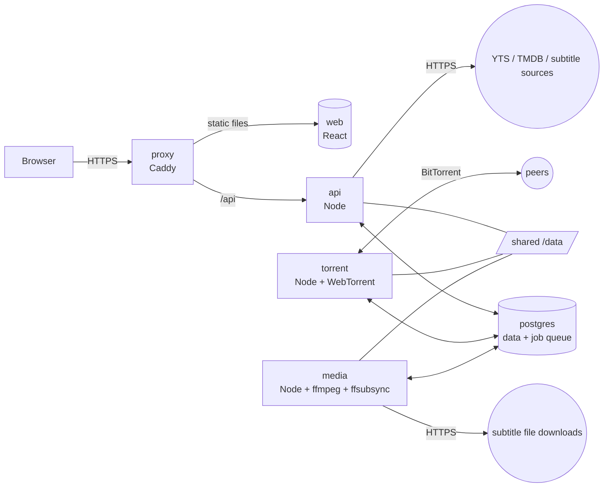

# 02 System architecture

## Overview



Five containers, one machine, one `docker-compose.yml`.

| Container | What it does | Why it's separate |
| --- | --- | --- |
| `proxy` | Caddy. Serves the web page's static files, forwards `/api` to `api`, handles TLS | Static files and TLS shouldn't be the application's job |
| `api` | Sign-in, every REST endpoint, live updates (SSE), streaming videos and exports, outbound queries to YTS / TMDB / subtitle sources. Listens on port 3000 inside the container; only `proxy` can reach it | The only program that talks to the browser |
| `torrent` | The WebTorrent client. Starts, pauses and removes downloads according to the state in the database, and reports progress | Downloads must not be interrupted when the site is updated and restarted; it's also the only container that opens a BitTorrent port to the outside |
| `media` | Runs the ffmpeg and ffsubsync background jobs: analysis, preview files, subtitle download and normalization, alignment, packing | CPU-heavy work must not slow the site down; only it needs the ffmpeg and Python in the image |
| `postgres` | All data, plus the job queue (pg-boss) | The specified database; using it as the queue means no Redis is needed |

`api`, `torrent` and `media` are **the same image** started with different commands. That way it only has to be built once, and the shared code can't end up at different versions.

## How the services talk to each other

The three Node programs **never call each other directly**; they communicate only through PostgreSQL and the shared `/data`:

| Channel | Purpose |
| --- | --- |
| Tables | The single source of state. For example, `api` sets `torrents.want` to `pause`, `torrent` sees it and carries it out, then changes `torrents.state` to `paused` |
| pg-boss queues | One-off jobs: analyze a film, make a preview file, align a subtitle, pack an MKV |
| `LISTEN` / `NOTIFY` | Wake the other side up, carrying no data. Three channels: `paiban_torrent` (there's a download to handle; `torrent` listens), `paiban_media` (there's a video or export state to handle; `media` listens), `paiban_events` (some row changed, payload `{type, id}`; `api` listens, and on receiving it queries the database and pushes to browsers; the list of types is in "Live updates" in [04-api.md](04-api.md)) |
| `/data` | The files themselves |

The benefit of this design is that no program loses work when it restarts: the state is in the database, so after a restart it reads it again and picks up where it left off.

**The tables are the truth; the queue is just a way to get someone to do something.** Concretely:

- To make something happen, write that row as "waiting" (e.g. `media_files.analysis_state = 'pending'`, `exports.state = 'queued'`), then `NOTIFY`. Whoever writes it doesn't need to know the queue exists; `torrent` never touches pg-boss at all.
- `media` has a **reconciliation** step: at startup, on receiving `paiban_media`, and every 60 seconds, it finds every row that is "waiting but has no matching job in the queue" and queues jobs for them. Each row's id is the queue's dedupe key, so queuing it twice doesn't create two jobs. Films being deleted (`want = 'remove'`) are skipped. Which rows reconciliation looks at and what it queues are listed in "Reconciliation" in [08-media-pipeline.md](08-media-pipeline.md).
- Each job's handler starts with a conditional update that changes the row from "waiting" to "running". If that changes nothing (0 rows affected), it simply ends. So even if the same thing is queued twice, it's done only once.
- When a job finishes, that last update is conditional too. If it changes nothing, the thing was deleted or cancelled while the job was working on it: the job deletes the files it just wrote, then ends ("What happens when a download is deleted" in [03-data-model.md](03-data-model.md)).

### Queues

| Queue | Contents | Handled by | Concurrency | `tasks` kind |
| --- | --- | --- | --- | --- |
| `media.analyze` | Probe the file, decide whether a preview file is needed, waveform, speech detection | media | 1 | `analyze` |
| `media.preview` | A film's preview assets: first `audio.m4a`, then `proxy.mp4` | media | 1 | `preview` |
| `export.mux` | Pack the MKV | media | 1 | `export` |
| `subtitle.search` | Ask one source for a film's subtitles | api | 1 per source | |
| `subtitle.resolve` | Ask the source for a candidate's current download URL, and download the file to `/data/tmp/uploads/<candidate id>/` | api | 1 per source | |
| `subtitle.fetch` | Extract the downloaded (or uploaded) file and turn it into a UTF-8 list of lines | media | 1 | |
| `subtitle.ingest` | Same as above; uploaded files and downloaded files go through the same job | media | (same as above) | |
| `subtitle.align` | The user pressed "Auto-align": align one added subtitle. Someone is waiting | media | 1 | `align` |
| `subtitle.rank` | For ranking: align one candidate in the background | media | 1 | `rank` (one row per ranking) |
| `storage.rescan` | Recount disk usage | media | 1 | `rescan` |

A few deliberate arrangements:

- **Only one transcode at a time.** `media.preview` is the most CPU-hungry job (a film can take tens of minutes to several hours), so only one film is done at a time, to avoid maxing out the CPU on a NAS.
- **Packing has its own lane.** `export.mux` doesn't re-encode and is limited almost only by disk speed; it usually takes less than a minute. It isn't queued behind transcoding: a user who presses Export shouldn't wait for another film to finish converting.
- **Foreground and background alignment are separate.** `subtitle.align` is someone pressing a button and waiting; `subtitle.rank` is a background job that ranks thirty at a time. With two queues, the foreground isn't blocked by the background.
- **Outbound queries are jobs too.** `subtitle.search` and `subtitle.resolve` are handled by `api` itself (only it has the keys). They are jobs rather than direct calls inside a request so that an `api` restart never leaves a source stuck in "Searching…" forever. Like `media`'s jobs, they have no separate queue: `subtitle_searches` rows with `state = 'running'`, and candidates with `fetch_state = 'fetching'` that don't have a temporary file yet, are the to-do list; each source has one line that handles them in order, and when `api` restarts it carries on from the tables.
- **Subtitle files are downloaded by `api` and processed by `media`.** Assrt (Shooter)'s download URLs are temporary and can't be stored in a table, and there's no queue to hand them to `media`; so once `api` gets the URL it downloads directly into the same temporary folder as uploads (`/data/tmp/uploads/<candidate id>/`, the file plus a `manifest.json`), and `media` then extracts it from there and turns it into a list of lines. From then on `media` never needs to reach the outside.

The `tasks` table is for people to look at: the administrator's "System status" page reads it, and failed ones can be retried from there. Only jobs with an entry in the rightmost column above have `tasks` rows; the rest are short, and their state is already visible in the candidate list and source status. pg-boss's own tables are not used for display.

`tasks` is also where jobs hand results back to `api`: `media` writes the result into `tasks.result`, changes `state` to `done`, then `NOTIFY paiban_events` (type `task`); the waiting request reads the result once it gets the notification. Details are in "Common rules for jobs" in [08-media-pipeline.md](08-media-pipeline.md).

## Disk layout

All files live under one mount point, `/data`, and it must be **one file system** (usage calculation and moves both assume so).

```
/data
├── torrents/<info_hash>/…          Content downloaded by WebTorrent, keeping the torrent's own directory structure. Read-only
├── media/<media_id>/
│   ├── probe.json                  ffprobe result
│   ├── peaks.bin                   Waveform
│   ├── ref.npz                     ffsubsync's speech cache
│   ├── speech.json                 The same speech data, for the browser and the sync core
│   ├── audio.m4a                   Only for versions that can't be played directly
│   └── proxy.mp4                   Same as above
├── subtitles/<subtitle_id>/
│   ├── original.<ext>              The downloaded or uploaded original file, untouched
│   ├── cues.json                   List of lines (UTF-8). Syncing, display and export all use this one
│   └── cues.original.json          Only if Simplified-to-Traditional conversion was done on adding: the list of lines before conversion
├── subtitles/candidates/<candidate_id>/…   Candidates fetched but not yet added: original.<ext> and cues.json
├── exports/<export_id>/
│   ├── <file name>.mkv
│   └── tracks/<n>.srt              Subtitle tracks staged during packing; deleted once packing has a final result
├── posters/<yts_id>.jpg            Poster cache for films in libraries (tiny, not counted in usage)
└── tmp/
    ├── uploads/<uuid>              Files users upload, written by api, deleted when the job processing them ends
    └── work/<job_id>/              media's working directory (scratch for extraction and alignment), deleted when the job ends
```

`tmp/` is scratch space for work in progress, not user files: every job deletes what it used when it ends (whether it succeeded or failed), and `media` empties `tmp/work/` at startup. This doesn't conflict with the "no automatic deletion" rule; see [10-storage.md](10-storage.md).

Large files (preview videos, audio files, exports) are always written as `*.part` first and renamed when complete. That way any file with its final name is guaranteed to be complete. `*.part` only appears under `/data/media` and `/data/exports` (and `tmp/`); `/data/torrents` is WebTorrent's territory, and our code neither writes files there nor looks for `*.part` there.

Subtitle and candidate files are small and don't use `.part`: they are prepared in `tmp/work`, the whole folder is moved to `/data/subtitles/…` (same file system, so the move is instant), and only then is the database updated.

## Code layout

pnpm monorepo.

```
paiban/
├── apps/
│   ├── web/                React single-page app
│   └── server/             Node. Three entry points: src/api.ts, src/torrent.ts, src/media.ts
├── packages/
│   └── shared/             Shared by front and back end: API types and zod schemas, sync core, constants, error codes
├── deploy/                 Dockerfile, docker-compose.yml, Caddyfile, .env.example; the local .env also lives here (not under version control)
├── tools/fakes/            Stand-ins for development and testing: fake YTS, fake subtitle source, local seeding (see 15-testing.md)
├── scripts/                Small tools that don't ship, e.g. the phase 0 check scripts
├── db/                     Reference schema and its tests (included in this handover pack; for its role after phase 1 see 14-plan.md)
├── fixtures/               Test fixtures (included in this handover pack)
├── docs/                   Spec (included in this handover pack, kept up to date during implementation)
├── prototype/              Prototypes (reference only, not shipped)
└── reference/              Reference code (reference only, not shipped)
```

The handover pack also has a `contracts/` folder. It and `packages/shared/src/sync-core/` move into `packages/shared` in phase 1, and after that it no longer exists.

`apps/server/src` is best split into folders by domain rather than by technical layer: `auth/`, `yts/`, `torrents/`, `storage/`, `media/`, `subtitles/` (containing `providers/`), `sync/`, `exports/`, `admin/`, `events/`, `db/`.

The sync core moves from `packages/shared/src/sync-core/core.ts` into `packages/shared`, so the browser and the server use the same copy; `packages/shared/src/contracts/api.ts` moves in too. Both move in phase 1 (moved, not copied: only one copy remains), and later phases use them directly. What has to change along with the move is listed under phase 1 in [14-plan.md](14-plan.md).

## Technology choices

Versions are the latest stable releases as of October 2026. During implementation, use whatever is the latest stable release at the time, **but pin WebTorrent and ffsubsync to the versions in the table first**, because the behavior in this spec was tested on those two versions.

| Purpose | Choice | Version | Notes |
| --- | --- | --- | --- |
| Runtime | Node.js | 24 LTS | WebTorrent 3 requires 22 or later. Both 22.22 and 24.21 were tested |
| Package manager | pnpm | 12 | |
| Language | TypeScript | 7 | The `.ts` files in `reference/` were checked with 7.0.2 in strict mode. Fall back to 5.x if the toolchain is incompatible |
| Back-end framework | Fastify | 5 | `@fastify/cookie`, `@fastify/multipart`, `@fastify/static`, `@fastify/rate-limit` |
| Database | PostgreSQL | 17 | The reference schema was run on PGlite (PostgreSQL 18). If you use the official 18 image, note that its data directory location differs from 17 |
| Database access | `pg` plus hand-written SQL; migrations are plain SQL files (`apps/server/migrations/`) | 8 | Drizzle was originally planned and dropped during implementation; see `docs/changes.md` 2026-10-06. `0001_init.sql` is the handed-over `db/schema.sql`, and a test confirms the two are equivalent |
| PostgreSQL driver | pg | 8 | `LISTEN` uses a dedicated connection, not one borrowed from the pool |
| Job queue | No separate queue: a job is a "waiting" row in a table, claimed with a conditional update | | pg-boss was originally planned; see `docs/changes.md` 2026-10-06 |
| Validation | zod | 4 | Schemas live in `packages/shared`, shared by front and back end |
| Password hashing | `@node-rs/argon2` | 2 | argon2id |
| Logging | pino | 10 | JSON to stdout |
| Torrent | webtorrent | **3.0.21** | Pure ESM |
| HTML parsing | cheerio | 1.2 | Only YIFY Subtitles needs it |
| Encoding conversion | iconv-lite | 0.7 | |
| Traditional/Simplified conversion | opencc-js | 1.4 | |
| Subtitle parsing | subsrt-ts, ass-compiler | 2.1 / 0.1 | Or equivalent libraries; `reference/subtitles/` has a minimal working ASS conversion |
| Audio/video processing | ffmpeg | 6 or later | Commands were tested on 6.1.1. The image (Debian trixie) ships 7.1.5; phase 0 reran every reference command on it, with results identical to 6.1.1 (analysis output byte-for-byte identical) |
| Speech detection and alignment | ffsubsync | **0.5.1** | Python 3.11 to 3.13, installed in a separate virtual environment |
| Front-end framework | React | 19 | |
| Build | Vite | 8 | |
| Routing | React Router | 8 | |
| Server state | TanStack Query | 5 | |
| Workbench state | Zustand | 5 | Sync doc, undo history, selection, timeline view |
| Long lists | TanStack Virtual | 3 | A film has over a thousand subtitle lines |
| ASS rendering | JASSUB | 2.5 | Only needed when doing "Keep ASS styles" (D34) |
| Testing | Vitest, Playwright | 5 / 1.63 | |
| Reverse proxy | Caddy | 2 | |

The front end brings in no component library. The prototypes' visuals are hand-written CSS, not much of it; follow the tokens in [17-ui.md](17-ui.md).

For lint and formatting, use ESLint plus Prettier, or Biome; pick one. The scope is `apps/`, `packages/`, `tools/`, `scripts/`; `prototype/`, `reference/` and `fixtures/` are excluded (they're handed-over material and stay as they are). TypeScript uses strict. The code in `reference/` was checked under strict without `noUncheckedIndexedAccess`; to turn that option on, the sync core needs a round of changes first.

## Configuration

There are two kinds of configuration; don't mix them.

**Environment variables**: things decided at deployment that don't change while running. Everything the person deploying has to fill in is listed in `deploy/.env.example`; copy it to `deploy/.env` (next to the compose file, so compose can read it) and fill it in. The few in the table below that aren't in that file (`DATABASE_URL`, `DATA_DIR`, `NODE_ENV`, `FFSUBSYNC`, `FFS_PYTHON`) are set by the compose file and the image, and nobody has to fill them in.

| Variable | For | Description |
| --- | --- | --- |
| `DATABASE_URL` | all | |
| `DATA_DIR` | all | Always `/data` inside the container |
| `PUBLIC_URL` | api | The beginning of invite links and reset links |
| `SECRET_KEY` | api | Encrypts the keys administrators enter. Only `api` has it |
| `BOOTSTRAP_ADMIN_USERNAME` / `_PASSWORD` | api | Creates the first administrator when the database has no users |
| `STORAGE_LIMIT_GB` | api | The **initial value** of the storage limit, written once only if the settings table has no limit yet |
| `STORAGE_RESERVE_GB` | all | Free space always left for the system, default 2 |
| `TORRENT_PORT` / `TORRENT_DHT_PORT` | torrent, api | BitTorrent incoming ports. `api` only uses them for display |
| `FFSUBSYNC` / `FFS_PYTHON` | media | Paths to the executables in the virtual environment |
| `LOG_LEVEL` | all | Default `info` |
| `NODE_ENV` | all | `production` in production (the image's default) |

There are also three variables **only for development and testing**. They must never appear in the production compose file; with `NODE_ENV=production`, if any one of them is set, the program refuses to start and says why. Usage is in [15-testing.md](15-testing.md).

| Variable | For | Description |
| --- | --- | --- |
| `ALLOW_LOCAL_SOURCES` | api, media | When set to `1`, outbound requests may use `http://` and reach internal addresses, and validation of the YTS and YIFY addresses is relaxed too. So that the fake YTS and fake subtitle source can work |
| `SOURCE_OVERRIDES` | api, media | JSON that replaces fixed source hosts with other URLs, e.g. `{"www.justsubtitles.com": "http://fake-sources:8090/justsubtitles"}`. Only takes effect when `ALLOW_LOCAL_SOURCES=1` |
| `TORRENT_TEST_PEERS` | torrent | After adding a torrent, connect straight to these addresses (`host:port`, comma-separated), and turn off DHT and trackers. For offline download tests |

**Settings in the database** (the `settings` and `secrets` tables): things administrators adjust in the interface. The list is in [13-settings.md](13-settings.md). Programs must not cache them for more than a few seconds; `torrent` and `media` reread them at the start of every job.

## Startup and shutdown

- **Database migrations** are run by `api` at startup (single instance, so no contention). `torrent` and `media` wait at startup until the schema version is in place before starting work: they query the migration tool's record table, and if the latest entry differs from the one built into the program, they wait 2 seconds and look again. They never run migrations themselves.
- **When `api` starts**: check the environment variables (exit if test-only variables appear in production) → run migrations → create the first administrator (if needed) → write the initial limit (if needed) → start accepting requests, start handling `subtitle.search` and `subtitle.resolve`.
- **When `torrent` starts**: add the items with `state = 'downloading'` in the database back to the client. If the last shutdown was clean, resume quickly from the saved bitfield; if not, let WebTorrent re-verify the files. Details are in [06-torrent-worker.md](06-torrent-worker.md).
- **When `media` starts**: empty `/data/tmp/work`; delete leftover `*.part` files under `/data/media` and `/data/exports`; set anything left "running" last time back to "waiting"; then do one reconciliation to queue jobs for them again. This works because only `media` handles these jobs, and it has only just started, so anything "running" is left over from last time. How each kind is handled is listed in "Reconciliation" in [08-media-pipeline.md](08-media-pipeline.md).
- **Shutdown**: on SIGTERM, stop taking new jobs. `torrent` saves each running download's bitfield to the database and marks it as cleanly shut down; `media` terminates its ffmpeg child processes and deletes their `*.part` files. `torrent`'s `stop_grace_period` in compose is 30 seconds.
- Every service updates `service_heartbeats` every 10 seconds. If one hasn't updated for over 30 seconds, the admin pages show it as not responding.

## Outbound connections

| Who | Connects to | What for |
| --- | --- | --- |
| api | The YTS domain set by the administrator | Search, film data, posters |
| api | `api.themoviedb.org` | Turning IMDb IDs into TMDB IDs, Chinese titles |
| api | The APIs of JustSubtitles / SubDL, YIFY Subtitles, Assrt (Shooter) | Subtitle search; asking for download URLs |
| media | Each source's subtitle file download hosts | Downloading candidates |
| torrent | BitTorrent peers, trackers, DHT | Downloading |

The browser connects only to `proxy`. Every outbound request has a timeout (10 seconds by default) and a response size limit, and connects only to hosts allowed in the settings; details are in "Outbound requests" in [12-auth.md](12-auth.md).

If BitTorrent traffic should go through a VPN, you can attach just the `torrent` container to the VPN container's network (e.g. `network_mode: "service:<vpn container>"`), and the other containers are unaffected. This is a deployment choice; the code doesn't need to do anything for it.

## Logging

- pino JSON, every line carrying `service`, and `reqId` (api) or `jobId` (media).
- **Things that must never appear in logs**: passwords, session values, `SECRET_KEY`, any API key or token, full URLs that contain keys (strip the query string when logging URLs), the text content of subtitles.
- Things users do (sign in, download, delete, change settings) are written separately to `audit_log`, for the administrator's "Activity log" page.
