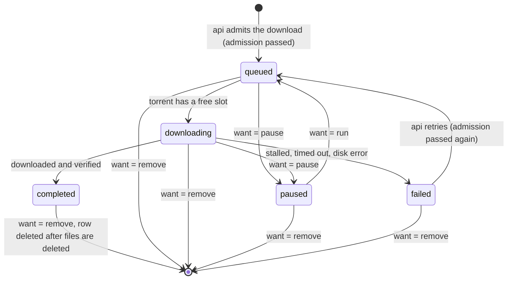

# 03 Data model

Columns, types and constraints follow `db/schema.sql` (it has actually run in an embedded PostgreSQL; the tests are in `db/schema.test.mjs`). This document explains what each table is for, how states change, and who may change which columns; for these behaviors, this document is authoritative.

The real project defines the schema with Drizzle and generates migration files, but the columns, check constraints and indexes must be equivalent to `db/schema.sql`. Keep the one view and three functions in `db/schema.sql` as SQL; do not rewrite them as application logic: `storage_usage`, `storage_used_bytes()`, `storage_admit()`, `provider_take_slot()`.

## Tables at a glance

| Table | One row is | Owns files |
| --- | --- | --- |
| `users` | a user | |
| `sessions` | a signed-in device | |
| `invites` | an invite code | |
| `password_resets` | a password reset link | |
| `settings` | a setting | |
| `secrets` | an encrypted key | |
| `provider_cache` | the result of one outbound query (parsed and cleaned by us, not the raw response) | |
| `source_health` | the latest status of one external source | |
| `provider_slots` | the next time a source may be sent a request | |
| `movies` | a film someone has downloaded (for films added by hand that YTS doesn't have, `yts_id` is empty and the TMDB id tells them apart) | poster (not counted in usage) |
| `torrents` | a download (one info hash). `origin` is `yts` or `manual` (added by hand; stores `metainfo` and `trackers`) | `/data/torrents/<hash>` |
| `torrent_inspections` | a magnet link or .torrent file that is about to be added by hand ([06-torrent-worker.md](06-torrent-worker.md), "Adding by hand (Brian, 2026-10-09; D26)"). Deleted once added | |
| `torrent_holders` | "someone holds a download" | |
| `media_files` | the main video file of a finished download and its derived files | `/data/media/<id>` |
| `subtitle_searches` | the latest search for a film on a source | |
| `subtitle_candidates` | a candidate subtitle | `/data/subtitles/candidates/<id>` |
| `subtitles` | an added subtitle and its sync doc | `/data/subtitles/<id>` |
| `subtitle_revisions` | a past version of a sync doc | |
| `exports` | an export | `/data/exports/<id>` |
| `notifications` | a notification for a user | |
| `audit_log` | an activity log entry | |
| `tasks` | a visible background task | |
| `storage_findings` | an orphan folder, or a record whose file has gone missing, found while recalculating usage | |
| `service_heartbeats` | a service's heartbeat | |

## Two rules that run through everything

1. **Tables that own files have no "clean up when expired" column, and no program deletes their rows on a schedule.** Deletion happens only because someone pressed delete.
2. **Every byte that counts toward the storage limit is a column in a table.** How much is used is a query (`storage_usage`); whether more can fit is a function (`storage_admit`). Do not add things up separately in the application.

## Downloads: `torrents`

One row per info hash, however many people want it.

### The two state columns

| Column | Written by | Values |
| --- | --- | --- |
| `want` | only `api` | `run`, `pause`, `remove`: what the user wants it to be |
| `state` | only `torrent` (exception: `api` writes `queued` on create and retry) | `queued`, `downloading`, `paused`, `completed`, `failed`: what it actually is |

The job of `torrent` is to make `state` catch up with `want`. Each side writes only its own column, so they never overwrite each other. `torrent` always updates `state` with a condition (for example `where id = $1 and state = 'queued' and want = 'run'`); if the condition fails, things have changed, so it reads again and then decides.

When `api` writes `want`: pausing sets `pause`; resuming and retrying set `run`; the last holder removing it, or an administrator force deleting it, sets `remove`.

**A row with `want = 'remove'` is being deleted.** From that moment on, every endpoint treats it as nonexistent (returns `NOT_FOUND`), and lists leave it out. The only exception is `POST /api/torrents` hitting the same info hash: it returns `TORRENT_STATE`, and the interface asks the user to try again later (deletion usually finishes within a few seconds).

### How the state changes

After `completed`, `state` no longer changes until removal. While seeding, `uploaded_bytes` and `seeding` keep being updated. The analysis and preview file states after completion live in `media_files`.

`phase` only means something during `downloading`: `metadata` (still asking peers for the torrent info) → `data` → (when needed) `verifying`.

### Statuses in the interface

The `TorrentStatus` the API returns to the frontend is computed, not stored:

| `state` | `media_files.analysis_state` | Shown as |
| --- | --- | --- |
| `queued` | | Queued |
| `downloading` | | Downloading |
| `paused` | | Paused |
| `failed` | | Failed |
| `completed` | `pending` or `running` | Analyzing |
| `completed` | `ready`, `failed`, `none` | Done (`ready`) |

When analysis fails, the film still counts as done and can be opened in the workspace; it just has no waveform or speech data, and the workbench explains this and offers a retry.

The library (`GET /api/library`) lists downloads with `state = 'completed'`, so it includes films that are "Analyzing": they can already be opened in the workspace to find subtitles; only the waveform isn't ready yet.

### Columns that count toward storage

| Column | When it counts |
| --- | --- |
| `size_bytes` | The size YTS lists. Used to check space when the download is admitted |
| `length_bytes` | The actual size once the torrent info arrives. Takes precedence when larger than `size_bytes` |
| `preview_reserve_bytes` | The amount reserved for preview assets, computed from the settings at the time the download is admitted; "whether to make a preview video, and at what resolution" is recorded in `preview_proxy_res` at the same time (D40). On completion both values are moved unchanged to `media_files`, and the reservation here goes to zero |
| `disk_bytes` | Actual space used. Measured on every failure (leftovers), and again on completion (the whole folder) |

The three unfinished states count `max(size_bytes, length_bytes) + preview_reserve_bytes`; `failed` counts `disk_bytes`; `completed` counts `disk_bytes`. Rules and examples are in [10-storage.md](10-storage.md).

### Live view: `torrent_live`

Temporary data (unlogged) that only has content while a download details page is open: `wanted_until` (pushed back 10 seconds each time the page asks for data), `data` (the latest `TorrentLive`), `updated_at`. Deleted along with the download. See "Live view (download details page)" in [06-torrent-worker.md](06-torrent-worker.md).

### Holders: `torrent_holders`

- The person who creates the download automatically becomes the first holder.
- After that, each person who wants the same version adds a row.
- A holder removing themselves: delete their row. If no holders are left after that, set `want` to `remove` in the same transaction.
- **Zero holders but still present** has only one cause: the last holder's account was removed by an administrator. Such a download stays on disk, appears on the administrator's Storage page, and the administrator decides whether to delete it. Removing an account must not delete files along with it.

`requested_by` is the person who started the download; it is only used for the "concurrent downloads per person" limit.

`last_used_at`: updated when someone opens this film's workspace or creates an export for it, at most once per hour per row. It is only used to show "last used" on the Storage page, to help people decide which film to delete; no program acts on it.

## Videos and derived files: `media_files`

Created by `torrent` when a download completes, in the same transaction as `torrents.state = 'completed'`. The main video file is the largest video file in the torrent (extensions `.mp4`, `.mkv`, `.avi`, `.mov`, `.m4v`, `.webm`).

| Columns | Values | Notes |
| --- | --- | --- |
| `probe_state` | `pending` → `running` → `ready` / `failed` | Probe (ffprobe). Done for every finished file; takes under a second. It has its own state so it can be claimed like other jobs, and so a file ffprobe can't read stays at `failed` instead of being retried over and over |
| `analysis_state` | `none` → `pending` → `running` → `ready` / `failed` | Waveform and speech. `none` means "automatic analysis is off and nobody has asked for it yet". Doesn't start until the probe has succeeded |
| `audio_state` | `none`, or `pending` → `running` → `ready` / `failed` | `audio.m4a`. Always `none` for versions that play directly |
| `proxy_state` | `none`, or `pending` → `running` → `ready` / `failed` | `proxy.mp4`. `none` when the file plays directly or automatic transcoding is off |
| `direct_play` | boolean | Only known after ffprobe. Rules are in [08-media-pipeline.md](08-media-pipeline.md): H.264 (8-bit 4:2:0) with AAC or MP3 in MP4; or VP8, VP9, AV1 with Opus or Vorbis in WebM |
| `reserve_bytes` | bytes | Reservation held by preview assets that aren't done yet. Recomputed on every state change: each asset that is in progress or waiting counts its estimate; the rest count 0 |
| `asr_state`, `asr_language` | `none`, or `pending` → `running` → `ready` / `failed`; the language heard | Speech recognition (`asr.json`); starts only after analysis is done. `none` means recognition is off or the film has no sound. A failure isn't retried; "Analyze again" queues it once more |
| `analysis_bytes`, `audio_bytes`, `proxy_bytes` | bytes | Actual sizes, written when the file is done. `analysis_bytes` is the total of `probe.json`, `peaks.bin`, `ref.npz`, `speech.json`, `asr.json` |
| `error` | `{analysis?, audio?, proxy?, asr?}`, one error code slot per asset | That asset's failure, or why no preview video was made (`PREVIEW_NO_SPACE`). Cleared when that asset is requested again. The list of codes is `MediaErrorCode` in `packages/shared/src/contracts/api.ts` |

An asset's reservation is released only when its last attempt also fails (see "Common rules for jobs" in [08-media-pipeline.md](08-media-pipeline.md)); to make it again after that, it has to pass admission again.

## Subtitles

### Candidates: `subtitle_searches` and `subtitle_candidates`

- One `subtitle_searches` row per film per source, recording the state and result count of the latest search.
- Search results are written to `subtitle_candidates`. When the same source is searched again, old results **whose file hasn't been fetched yet** (`new`) and **whose fetch failed** (`failed`) are replaced by the new results; those whose file has already been fetched are kept (they come from the user pressing "Auto-align and rank all" or "Add"). Only the languages this search covers are replaced (Traditional Chinese covers every Chinese guess, Simplified Chinese covers `zh-Hans` and `zh`, English only `en`), so searching only English doesn't wipe out Chinese candidates found earlier that haven't been fetched. When the source fails this time, nothing is replaced.
- Uploaded files are candidates too: `provider = 'upload'`, `provider_ref` is the file's sha256, `release_name` is the file name. **The row is created as soon as the file is received** (`fetch_state = 'fetching'`) and becomes `ready` or `failed` after processing; that way an unreadable file stays on the list as "failed" with an explanation instead of silently disappearing. An archive with several subtitle files produces that many candidates. Uploading the same file again doesn't add a row: one that is already `ready` is returned as is, and a `failed` one is processed again.

`fetch_state`: `new` → `fetching` → `ready` / `failed`. `ready` means the file has been downloaded, extracted and turned into a UTF-8 list of lines, and `language` has been changed to the result detected from the content. On `failed`, `fetch_error` is the reason:

| `fetch_error` | Meaning |
| --- | --- |
| `DOWNLOAD_FAILED` | Couldn't fetch it: timeout, the source returned an error, or the download URL's host isn't on the allowlist |
| `ARCHIVE_INVALID` | The archive won't open, or breaks the extraction limits |
| `NO_SUBTITLE` | The archive opens, but there's no subtitle file in it |
| `PARSE_FAILED` | The file was read, but no line could be parsed from it |

Failed candidates stay on the list, and the user can remove them (`DELETE /api/candidates/:id`; any candidate can be removed this way, along with the file it fetched). A failed candidate can't be "added"; to try again, search again (failed ones from the same source are replaced by the new results) or upload again.

`fetch_started_at` is when it became `fetching`. A candidate stuck in `fetching` for more than 10 minutes is changed to `failed` (`DOWNLOAD_FAILED`) by the reconciliation step in `media`: that usually means the program handling it was restarted midway. This way the list never has rows that are "Processing" forever.

`align_state`: `none` → `queued` → `running` → `done` / `failed`. On `done`, `align_score` and `align_result` have values.

`download_url` always has its query string stripped before it is stored (D28).

### Added: `subtitles`

"Add" copies the candidate's files to `/data/subtitles/<new id>/` and creates a row:

- The folder holds `original.<ext>` (the original bytes) and `cues.json` (the list of lines, which every other place uses from then on). If Simplified-to-Traditional conversion was done on add, `cues.json` is the converted one, the pre-conversion one is saved as `cues.original.json`, and `converted_s2t = true`.
- `format` is the original file's format; `.ssa` is recorded as `ass`.
- `doc` is the sync doc (type `SyncDoc`, defined in `packages/shared/src/sync-core/core.ts`). If the candidate has already been aligned, the initial `doc` uses that result; otherwise it is "unchanged".
- `doc_rev` starts at 0 and goes up by 1 on each save. "Confirm" doesn't change the doc, so it doesn't add 1 (it saves a history entry and sends a `subtitle` event whose `rev` is the same). A save must carry the original `rev`; if it doesn't match, the save is rejected (`REVISION_CONFLICT`).
- `status`: `draft` or `confirmed`. **A save that changes timing or text (the `segments` or `edits` sent differ from those in the database) turns it back into `draft`**; a save that only touches anchors or checkpoint states doesn't. Only "Confirm" turns it into `confirmed`.
- `score`: the sync score computed at the last save (computed by the server; numbers sent by the frontend are not used).
- `updated_by`: the person who saved last. Used to tell the other person who made the change when there is a revision conflict.
- `(torrent_id, sha256)` is unique: the same film can't have two subtitles with exactly the same content added. `sha256` is the hash of `cues.json` (that is, the content after Simplified-to-Traditional conversion).

Subtitles belong to "the film", not to any one person. All holders see the same copy and edit the same copy.

### History: `subtitle_revisions`

A snapshot is saved at three moments: on confirm, when an auto-align result is applied, and on reset all. The latter two are told to the server by the frontend with `reason` when saving (`reason: 'auto-align' | 'reset'` on `PUT /api/subtitles/:id/doc`). For now it is only used for tracking down problems and for a future "go back to a version" feature; the first version's interface doesn't show it.

## Exports: `exports`

`queued` → `running` → `done` / `failed`.

- `torrent_id` becomes null when the film is deleted, and the export is kept. That's why the film title and version for display are stored separately in `movie_title` and `version_label`.
- `tracks` records which subtitles were packed at the time (including their `rev`), so later changes to the subtitles don't affect files already exported.
- `reserved_bytes` counts toward usage while `queued` / `running`; after `done`, `size_bytes` counts instead. On failure both are 0; a half-written file is deleted by the job itself, and the reason is recorded in `error_code`.
- A user deletes an export that is still queued (`queued`): `api` deletes `tracks/` and the row directly, without waiting for `media`.
- A user deletes an export in progress (`running`): `api` sets `cancel_requested` to true; when `media` sees it, it kills ffmpeg, deletes the partial file, and deletes the row. From the moment it is set to true, lists and events treat it as already gone (`GET /api/exports` doesn't list it; deleting it again returns `NOT_FOUND`). If `media` happens to restart in between, it cleans up such rows on startup (deletes `tracks/` and the row).
- The source film is deleted halfway through packing: this export fails (`SOURCE_MISSING`) and its reservation is released.

## Settings and keys

- `settings`: one row per setting; `value` is JSON. The list of keys and validation rules are in [13-settings.md](13-settings.md).
- `secrets`: three keys (`tmdbKey`, `subdlKey`, `assrtToken`), encrypted with AES-256-GCM using `SECRET_KEY`. The API only reports "whether it is set", never the content. (The former `llmKey` was moved into the first LLM profile during the upgrade and then deleted.)
- `llm_profiles`, `llm_usage`, `translations`: language model profiles (keys are encrypted the same way, with additional data `llm:<id>`), a record of each call, and subtitle translation progress (translated lines are stored in `lines`; subtitles are written out only on completion). See [18-llm.md](18-llm.md); migration `0005_llm.sql`. Subtitle `provider` gains a `translated` value (AI translation), and `language` can be any BCP 47 language code. On 2026-10-09 another value was added, `bundled` (subtitles that came with the download; `added_by` is empty; migration `0008_bundled_subtitles.sql`).

## Activity

- `notifications`: `kind` plus `data` (film title, version, who…). Sentences are put together by the frontend, so no Chinese is stored here.
- `audit_log`: `action` is a stable code (the list is in [12-auth.md](12-auth.md)); `target` is data about the object (film title, version, name…), again with no sentences stored; `actor_name` is stored separately, so entries still make sense after the account is removed.
- `tasks`: visible background tasks, of kinds `analyze`, `preview`, `align`, `rank`, `export`, `rescan`. pg-boss decides when jobs run; `tasks` is responsible for three things: showing them on the "System status" page (`subject` is the data needed for display), letting failed jobs be retried (`input` is the original parameters, only ids and options, never subtitle content), and handing results back to `api` (`result`). Who creates the row and when it becomes `cancelled` is written in "Common rules for jobs" in [08-media-pipeline.md](08-media-pipeline.md).
- `source_health`: one row per external source, recording the result of the latest query or test (status, code, data, time). Read by the Overview page and the Sources page.
- `storage_findings`: things that didn't add up in the latest usage recalculation. Replaced as a whole batch on every recalculation.
- `service_heartbeats`: one row for each of the three Node services.
- `provider_slots`: one row per source, recording the next time a request may be sent. Slots are taken with `provider_take_slot()`; see [07-subtitle-providers.md](07-subtitle-providers.md).

`notifications`, `audit_log` and `tasks` keep growing. They are text only and small, so they aren't cleaned up; pages read them with pagination. pg-boss maintains its own tables (archiving, clearing finished jobs); that is internal to the queue and has nothing to do with users' files.

## Transaction boundaries

Each of the following actions must be completed in **one database transaction**:

| Action | What the transaction does |
| --- | --- |
| Admitting a download | First use `select … for update` to find a row with the same info hash. If there is one and `want` is not `remove`: treat it as "joining someone else's download". If there is one and it is `remove`: return `TORRENT_STATE`. If there is none: `storage_admit(need)` → only on success write `movies` (if missing), `torrents` (including the preview reservation and preview plan), `torrent_holders`. When two people download the same brand-new version at once, neither finds a row to lock, and the one that writes later hits the unique constraint on `info_hash`: catch that error and rerun the whole transaction; this time it finds the row and becomes a "join" |
| Joining someone else's download | Lock the row, make sure `want` is not `remove`, write `torrent_holders` (no admission needed) |
| Retrying a failed download | `storage_admit(max(size_bytes, length_bytes) + preview_reserve_bytes, disk_bytes)` → only on success change `state` to `queued` and `want` to `run`. The preview reservation and preview plan stay on the row the whole time it is failed (they just don't count toward usage) and are reused as is on retry |
| Finding out from the torrent info that it is larger than listed | Extra amount within 64 MB: write `length_bytes` directly. Over that: `storage_admit(difference)` → only on success write it; on failure write `length_bytes` and mark it failed (`SIZE_MISMATCH`). Details are in [06-torrent-worker.md](06-torrent-worker.md) |
| A holder removing it | Lock the row, delete from `torrent_holders`; if no holders are left, set `want` to `remove` |
| Download completing | `state = 'completed'`, measure `disk_bytes`, create `media_files` (reservation and preview plan moved over from `torrents`) |
| Requesting a preview file (afterwards) | `storage_admit(estimate for the missing assets)` → only on success set the missing assets to `pending` and write `reserve_bytes` |
| Starting an export | `storage_admit(estimate)` → only on success write `exports` |
| Saving a sync doc | Check `doc_rev` → update `doc`, `doc_rev + 1`, `status`, `score`, `updated_by` |

`storage_admit` takes an advisory lock inside, so concurrent requests queue up instead of both squeezing into the last bit of space.

"Join" and "remove" both lock the `torrents` row first, so it can't happen that "the last holder has just removed it while someone else joins at the same moment, and the joiner ends up with a film that is being deleted": whichever comes second sees the result of the first.

These transactions all use the default isolation level (READ COMMITTED). Correctness relies on the lock in `storage_admit`, row locks and conditional updates, not on a higher isolation level. Switching to REPEATABLE READ would actually break things: `storage_admit` wouldn't see the usage just written by whoever held the lock before.

## What happens when a download is deleted

Before that, in the same transaction in which `api` sets `want` to `remove`, it first handles **all exports** of this film (Brian, 2026-10-06: deleting a whole film deletes its exports too): queued, done and failed ones have their rows deleted directly (`tasks` marked `cancelled`), and `/data/exports/<id>` is deleted after the transaction; ones being packed get `cancel_requested` set and are deleted by `media` after it stops. When the creator is not the person who pressed delete, each creator receives an `item.deleted`. So by the time it reaches `torrent`, there are usually no exports of this film left.

Carried out by `torrent` (when it sees `want = 'remove'`):

1. Remove it from the WebTorrent client, without keeping the files.
2. Note the ids of the `media_files`, `subtitles` and `subtitle_candidates` under this download.
3. Delete `/data/torrents/<hash>`, `/data/media/<media id>`, and every `/data/subtitles/<id>` and `/data/subtitles/candidates/<id>`.
4. In one transaction:
   - If any exports of this film are still unfinished and haven't been asked to cancel (`queued`, `running`, with `cancel_requested` false; normally `api` has already dealt with them), mark them `failed` with reason `SOURCE_MISSING` and zero their reservation; mark their `tasks` `failed` as well; write an `export.failed` notification for each creator. This is a safety net: export rows are not cascade-deleted by foreign keys.
   - Mark other unfinished `tasks` under this download (`queued`, `running`) as `cancelled`.
   - Delete the `torrents` row. Foreign keys cascade-delete holders, videos, subtitles and candidates; `exports.torrent_id` and `tasks.torrent_id` become null.

   For exports marked failed in this step, `torrent` also deletes the `tracks/` left on disk right after this step (nobody else would clean up queued ones; an in-progress packing job also cleans up after itself, deleting from both sides isn't an error, and nothing is left behind even if `media` happens not to be running).
5. If the film no longer has any downloads, delete the `movies` row and the poster cache.
6. `NOTIFY`: `torrent.removed`, `usage`; one `task` for each changed `tasks` row (requests waiting on that job are woken up and the System status page updates); one `export` for each export marked failed; one `notification` for each notification.

The whole process can be rerun: if it crashes halfway, after a restart it sees `want = 'remove'` and does it again; deleting files that don't exist isn't an error.

**Deletion doesn't wait for other programs.** This film may have jobs running right then (making the preview file, fetching subtitles, packing). `torrent` doesn't wait for them; they stop on their own and leave nothing behind. This relies on every program that writes files under `/data` following these four rules (every kind of job in `media`, plus "add subtitles" in `api`):

- **Don't start work on a film that is being deleted.** Reconciliation and claiming both skip downloads with `want = 'remove'`.
- **Check every 2 seconds while running**: the row it is working on still exists, its state is still "in progress", and the download's `want` is not `remove`. If not, kill the child process, delete its own partial output, and exit.
- **Check once more before creating a folder, writing out a file, or renaming a `.part`.**
- **The final "I'm done" update must be conditional, with the condition in the same statement**: the row still exists, its state is still what it was when claimed, **and the download's `want` is not `remove`**. If nothing changes (0 rows affected), the thing was deleted, or is being deleted, while it was writing files: **delete the files it just wrote**, and also the folder it created if that is now empty. These are its own output, not anyone's files. Rows added along the way follow the same rule: the candidates added for multiple subtitle files, and the row `api` adds when adding subtitles, are all inserted with "the download exists and `want` is not `remove`" as the condition (`insert … select … from torrents where id = $1 and want <> 'remove'`); if nothing is inserted, delete the folder it just wrote.

The first three rules make jobs stop as soon as possible; the fourth guarantees that however the timing interleaves, no folder nobody knows about ever appears after the deletion. The key is `want`: it is already `remove` before `torrent` starts deleting anything, so any job that finishes after that is sure to change nothing with its final update; a job that finishes before that has its output deleted by `torrent` along with the folder.

Other consequences:

- All of this film's exports are deleted along with it (see the `api` step above). The job that is packing finds `cancel_requested` at its next check, kills ffmpeg, deletes the `.part` and `tracks/`, and then deletes the row.
- Cancelled `tasks` are kept as records, with an empty `torrent_id`.
