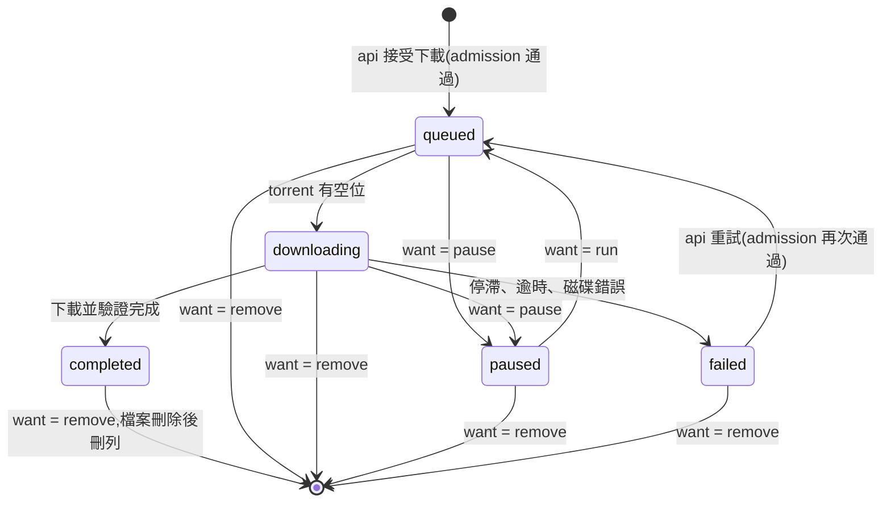

# 03 資料模型

欄位、型別和約束以 `db/schema.sql` 為準（它在嵌入式的 PostgreSQL 裡實際跑過，測試在 `db/schema.test.mjs`）。這份文件說明每張表是做什麼的、狀態怎麼變、誰可以改哪些欄位；這些行為以這份文件為準。

正式專案用 Drizzle 定義 schema 並產生遷移檔，但欄位、檢查條件和索引要和 `db/schema.sql` 等價。`db/schema.sql` 裡的一個 view 和三個函式請保留為 SQL，不要改寫成應用程式的邏輯：`storage_usage`、`storage_used_bytes()`、`storage_admit()`、`provider_take_slot()`。

## 資料表一覽

| 資料表 | 一列代表 | 擁有檔案 |
| --- | --- | --- |
| `users` | 一位使用者 | |
| `sessions` | 一個登入中的裝置 | |
| `invites` | 一個邀請碼 | |
| `password_resets` | 一個重設密碼連結 | |
| `settings` | 一項設定 | |
| `secrets` | 一把加密過的金鑰 | |
| `provider_cache` | 一筆對外查詢的結果（我們解析、清理過的，不是原始回應） | |
| `source_health` | 一個外部來源最近一次的狀況 | |
| `provider_slots` | 一個來源下一次可以發請求的時間 | |
| `movies` | 一部有人下載過的電影 | 海報（不計入用量） |
| `torrents` | 一個下載（一個 info hash） | `/data/torrents/<hash>` |
| `torrent_holders` | 「某人持有某個下載」 | |
| `media_files` | 一個下載完成的主影片檔和它的衍生檔 | `/data/media/<id>` |
| `subtitle_searches` | 某部片在某個來源的最近一次搜尋 | |
| `subtitle_candidates` | 一條候選字幕 | `/data/subtitles/candidates/<id>` |
| `subtitles` | 一條已加入的字幕和它的同步文件 | `/data/subtitles/<id>` |
| `subtitle_revisions` | 同步文件的一個歷史版本 | |
| `exports` | 一個匯出檔 | `/data/exports/<id>` |
| `notifications` | 給某位使用者的一則通知 | |
| `audit_log` | 一筆操作紀錄 | |
| `tasks` | 一個看得到的背景工作 | |
| `storage_findings` | 重新計算用量時發現的一個孤兒資料夾，或一筆檔案不見了的紀錄 | |
| `service_heartbeats` | 一個服務的心跳 | |

## 兩條貫穿全部的規則

1. **擁有檔案的資料表沒有「到期就清掉」的欄位，也沒有任何程式會定時刪它的列。** 刪除只會因為有人按了刪除。
2. **所有算進容量上限的位元組都是資料表裡的欄位。** 目前用了多少是一個查詢（`storage_usage`），能不能再放是一個函式（`storage_admit`）。不要在應用程式裡另外加總。

## 下載：`torrents`

一個 info hash 一列，不論有幾個人要。

### 兩個狀態欄位

| 欄位 | 誰寫 | 值 |
| --- | --- | --- |
| `want` | 只有 `api` | `run`、`pause`、`remove`：使用者希望它怎樣 |
| `state` | 只有 `torrent`（例外：`api` 在建立和重試時寫入 `queued`） | `queued`、`downloading`、`paused`、`completed`、`failed`：它實際上怎樣 |

`torrent` 的工作就是讓 `state` 追上 `want`。兩邊各寫各的欄位，就不會互相蓋掉。`torrent` 更新 `state` 時一律帶條件（例如 `where id = $1 and state = 'queued' and want = 'run'`），條件不成立就代表情況變了，重新讀再決定。

`api` 寫 `want` 的時機：暫停設成 `pause`；繼續和重試設成 `run`；最後一位持有人移除、或管理員強制刪除時設成 `remove`。

**`want = 'remove'` 的列正在被刪除。** 從這一刻起，所有端點都把它當成不存在（回 `NOT_FOUND`），清單裡也不列出。唯一的例外是 `POST /api/torrents` 遇到同一個 info hash：回 `TORRENT_STATE`，介面請使用者稍後再試（通常幾秒內就刪完了）。

### 狀態怎麼變

`completed` 之後 `state` 就不再變，直到被移除。做種時 `uploaded_bytes` 和 `seeding` 還會繼續更新。完成後的分析、預覽檔狀態都在 `media_files`。

`phase` 只在 `downloading` 時有意義：`metadata`（還在向 peers 要種子資訊）→ `data` →（必要時）`verifying`。

### 介面上的狀態

API 回給前端的 `TorrentStatus` 是算出來的，不是存起來的：

| `state` | `media_files.analysis_state` | 顯示 |
| --- | --- | --- |
| `queued` | | 排隊中 |
| `downloading` | | 下載中 |
| `paused` | | 已暫停 |
| `failed` | | 失敗 |
| `completed` | `pending` 或 `running` | 分析中 |
| `completed` | `ready`、`failed`、`none` | 完成（`ready`） |

分析失敗時電影仍然算完成、可以進工作區，只是沒有波形和人聲資料，工作台會說明並提供重試。

片庫（`GET /api/library`）列的是 `state = 'completed'` 的下載，所以包含「分析中」的片：它們已經可以進工作區找字幕了，只是波形還沒好。

### 計入容量的欄位

| 欄位 | 什麼時候算 |
| --- | --- |
| `size_bytes` | YTS 列出的大小。接受下載時用它檢查空間 |
| `length_bytes` | 拿到種子資訊後的實際大小。比 `size_bytes` 大時以它為準 |
| `preview_reserve_bytes` | 為預覽資產預留的量，接受下載時依當時的設定算好；同時把「要不要轉預覽影片、轉成什麼解析度」記在 `preview_proxy_res`（D40）。完成時這兩個值原封不動搬到 `media_files`，這裡的預留量歸零 |
| `disk_bytes` | 實際佔用。每次失敗時量一次（殘留），完成時再量一次（整個資料夾） |

未完成的三個狀態算 `max(size_bytes, length_bytes) + preview_reserve_bytes`；`failed` 算 `disk_bytes`；`completed` 算 `disk_bytes`。規則和例子在 [10-storage.md](10-storage.md)。

### 持有人：`torrent_holders`

- 建立下載的人自動成為第一位持有人。
- 之後每個要同一個版本的人加一列。
- 持有人移除自己：刪掉他那一列。如果刪完沒有任何持有人了，同一個交易裡把 `want` 設成 `remove`。
- **零持有人但仍存在**只有一種來源：最後一位持有人的帳號被管理員移除。這種下載會留在磁碟上，出現在管理員的儲存空間頁，由管理員決定刪不刪。帳號被移除不能連帶刪檔。

`requested_by` 是發起下載的人，只用來算「每人同時下載上限」。

`last_used_at`：有人開啟這部片的工作區、或替它建立匯出時更新，同一列最多每小時寫一次。它只用來在儲存空間頁顯示「最近使用」，幫人決定要刪哪一部；沒有任何程式會依它做事。

## 影片與衍生檔：`media_files`

下載完成時由 `torrent` 建立，和 `torrents.state = 'completed'` 在同一個交易裡。主影片檔是 torrent 裡最大的影片檔（副檔名 `.mp4`、`.mkv`、`.avi`、`.mov`、`.m4v`、`.webm`）。

| 欄位組 | 值 | 說明 |
| --- | --- | --- |
| `probe_state` | `pending` → `running` → `ready` / `failed` | 探測（ffprobe）。每個下載完成的檔案都會做，不到一秒。它有自己的狀態，是為了能像其他工作一樣被認領，也為了讓 ffprobe 讀不了的檔案停在 `failed`，不會被一試再試 |
| `analysis_state` | `none` → `pending` → `running` → `ready` / `failed` | 波形和人聲。`none` 是「自動分析關掉了，還沒有人要求」。探測沒有成功之前不會開始 |
| `audio_state` | `none`，或 `pending` → `running` → `ready` / `failed` | `audio.m4a`。能直接播的版本永遠是 `none` |
| `proxy_state` | `none`，或 `pending` → `running` → `ready` / `failed` | `proxy.mp4`。能直接播、或自動轉檔關掉時是 `none` |
| `direct_play` | 布林 | ffprobe 之後才確定。規則在 [08-media-pipeline.md](08-media-pipeline.md)：MP4 裡的 H.264（8-bit 4:2:0）加 AAC 或 MP3；或 WebM 裡的 VP8、VP9、AV1 加 Opus 或 Vorbis |
| `reserve_bytes` | 位元組 | 還沒做完的預覽資產佔的預留量。每次狀態變動時重算：進行中或等待中的資產各算它的估計值，其餘算 0 |
| `analysis_bytes`、`audio_bytes`、`proxy_bytes` | 位元組 | 實際大小，檔案完成時寫入。`analysis_bytes` 是 `probe.json`、`peaks.bin`、`ref.npz`、`speech.json` 的總和 |
| `error` | `{asset, code}` | 最近一次失敗，或沒有做預覽影片的原因（`PREVIEW_NO_SPACE`）。那個資產重新被要求時清掉。代碼的清單是 `packages/shared/src/contracts/api.ts` 的 `MediaErrorCode` |

資產在最後一次嘗試也失敗時（見 [08-media-pipeline.md](08-media-pipeline.md) 的「工作的共通規矩」），它的預留量才釋出；之後要再做，得重新通過 admission。

## 字幕

### 候選：`subtitle_searches` 和 `subtitle_candidates`

- 每部片每個來源一列 `subtitle_searches`，記錄最近一次搜尋的狀態和筆數。
- 搜尋結果寫進 `subtitle_candidates`。同一個來源重新搜尋時，**還沒抓過檔案的**（`new`）和**抓失敗的**（`failed`）舊結果被新結果取代；已經抓好檔案的保留（那是使用者按「排名」或「加入」的結果）。
- 上傳的檔案也是候選，`provider = 'upload'`，`provider_ref` 是檔案的 sha256，`release_name` 是檔名。**檔案一收到就建立這一列**（`fetch_state = 'fetching'`），處理完變成 `ready` 或 `failed`；這樣讀不了的檔案會以「失敗」的樣子留在清單上並說明原因，而不是無聲無息地消失。一個壓縮檔裡有幾個字幕檔，就產生幾條候選。同一個檔案再上傳一次不會多一列：已經 `ready` 的原樣回傳，`failed` 的重新處理。

`fetch_state`：`new` → `fetching` → `ready` / `failed`。`ready` 表示檔案已下載、解壓縮、轉成 UTF-8 的句子清單，`language` 也改成依內容判斷的結果。`failed` 時 `fetch_error` 是原因：

| `fetch_error` | 意思 |
| --- | --- |
| `DOWNLOAD_FAILED` | 抓不到：逾時、來源回錯誤、下載網址的主機不在允許清單裡 |
| `ARCHIVE_INVALID` | 壓縮檔打不開，或違反解壓縮的限制 |
| `NO_SUBTITLE` | 壓縮檔打得開，但裡面沒有字幕檔 |
| `PARSE_FAILED` | 檔案讀到了，但解析不出任何一句 |

失敗的候選留在清單上，使用者可以把它拿掉（`DELETE /api/candidates/:id`，任何候選都可以這樣移除，連同它抓下來的檔案）。失敗的候選不能「加入」；要再試，就重新搜尋（同一個來源裡失敗的會被新的結果取代）或重新上傳。

`fetch_started_at` 是它變成 `fetching` 的時間。停在 `fetching` 超過 10 分鐘的候選，由 `media` 的對帳步驟改成 `failed`（`DOWNLOAD_FAILED`）：那通常表示處理它的程式中途被重啟了。這樣清單上不會有永遠「處理中」的列。

`align_state`：`none` → `queued` → `running` → `done` / `failed`。`done` 時 `align_score` 和 `align_result` 有值。

`download_url` 存進去之前一律去掉 query string（D28）。

### 已加入：`subtitles`

「加入」把候選的檔案複製到 `/data/subtitles/<新 id>/`，建立一列：

- 資料夾裡有 `original.<ext>`（原始位元組）和 `cues.json`（句子清單，之後所有地方都用這一份）。加入時做了簡轉繁的話，`cues.json` 是轉換後的，轉換前的另存成 `cues.original.json`，`converted_s2t = true`。
- `format` 是原始檔的格式；`.ssa` 記成 `ass`。
- `doc` 是同步文件（型別 `SyncDoc`，定義在 `packages/shared/src/sync-core/core.ts`）。候選如果已經對齊過，初始的 `doc` 就用那次的結果；否則是「不動」。
- `doc_rev` 從 0 開始，每次儲存加 1。儲存時要帶上原本的 `rev`，不一致就拒絕（`REVISION_CONFLICT`）。
- `status`：`draft` 或 `confirmed`。**會改變時間或文字的儲存（送來的 `segments` 或 `edits` 和資料庫裡的不一樣）會把它變回 `draft`**；只動到對齊點或檢查點狀態的儲存不會。只有「確認」會把它變成 `confirmed`。
- `score`：最後一次儲存時算出的對齊分數（伺服器算，不採用前端送來的數字）。
- `updated_by`：最後一次儲存的人。版本衝突時用它告訴對方是誰改的。
- `(torrent_id, sha256)` 唯一：同一部片不能加入兩條內容完全相同的字幕。`sha256` 是 `cues.json` 的雜湊（也就是簡轉繁之後的內容）。

字幕屬於「那部片」，不屬於某個人。所有持有人看到同一份、改同一份。

### 歷史：`subtitle_revisions`

在三個時機存一份快照：確認時、套用自動對齊的結果時、全部重設時。後兩者是前端在儲存時用 `reason` 告訴伺服器的（`PUT /api/subtitles/:id/doc` 的 `reason: 'auto-align' | 'reset'`）。目前只用來追查問題和給未來的「回到某個版本」功能，第一版的介面不顯示。

## 匯出：`exports`

`queued` → `running` → `done` / `failed`。

- `torrent_id` 在電影被刪除時變成 null，匯出檔保留。所以顯示用的片名和版本另外存在 `movie_title`、`version_label`。
- `tracks` 記錄當時封裝了哪些字幕（含它們的 `rev`），之後字幕再被修改也不影響已經匯出的檔案。
- `reserved_bytes` 在 `queued` / `running` 時算進用量；`done` 之後改算 `size_bytes`。失敗時兩者都是 0，寫到一半的檔案由該工作自己刪掉，原因記在 `error_code`。
- 使用者刪除一個還在排隊的匯出（`queued`）：`api` 直接刪掉 `tracks/` 和這一列，不用等 `media`。
- 使用者刪除一個進行中的匯出（`running`）：`api` 把 `cancel_requested` 設成 true，`media` 看到後終止 ffmpeg、刪掉半成品、刪掉這一列。
- 封裝到一半，來源的電影被刪除：這次匯出失敗（`SOURCE_MISSING`），預留釋出。

## 設定與金鑰

- `settings`：一項一列，`value` 是 JSON。鍵的清單和驗證規則在 [13-settings.md](13-settings.md)。
- `secrets`：三把金鑰（`tmdbKey`、`subdlKey`、`assrtToken`），用 `SECRET_KEY` 以 AES-256-GCM 加密。API 只回報「有沒有設定」，永遠不回傳內容。

## 活動

- `notifications`：`kind` 加上 `data`（片名、版本、是誰…）。句子由前端組，所以這裡不存中文。
- `audit_log`：`action` 是穩定的代碼（清單在 [12-auth.md](12-auth.md)）；`target` 是對象的資料（片名、版本、名字…），同樣不存句子；`actor_name` 另外存一份，帳號被移除後紀錄仍然讀得懂。
- `tasks`：看得到的背景工作，種類是 `analyze`、`preview`、`align`、`rank`、`export`、`rescan`。pg-boss 決定工作什麼時候跑；`tasks` 負責三件事：給「系統狀態」頁顯示（`subject` 是顯示要用的資料）、讓失敗的工作能重試（`input` 是當初的參數，只放 id 和選項，不放字幕內容）、把結果交回給 `api`（`result`）。誰建立這一列、什麼時候變成 `cancelled`，寫在 [08-media-pipeline.md](08-media-pipeline.md) 的「工作的共通規矩」。
- `source_health`：每個外部來源一列，記最近一次查詢或測試的結果（狀態、代碼、資料、時間）。總覽頁和來源設定頁讀它。
- `storage_findings`：最近一次重新計算用量時，對不起來的東西。每次重新計算整批換新。
- `service_heartbeats`：三個 Node 服務各一列。
- `provider_slots`：每個來源一列，記下一次可以發請求的時間。用 `provider_take_slot()` 取號，見 [07-subtitle-providers.md](07-subtitle-providers.md)。

`notifications`、`audit_log`、`tasks` 會一直累積。它們只有文字，量很小，不清理；頁面用分頁讀。pg-boss 會維護它自己的資料表（封存、清掉完成的工作），那是佇列內部的事，和使用者的檔案無關。

## 交易的邊界

下面這些動作必須各自在**一個資料庫交易**裡完成：

| 動作 | 交易裡做的事 |
| --- | --- |
| 接受下載 | 先用 `select … for update` 找同一個 info hash 的列。有而且 `want` 不是 `remove`：當成「加入別人的下載」。有而且是 `remove`：回 `TORRENT_STATE`。沒有：`storage_admit(need)` → 通過才寫入 `movies`（沒有的話）、`torrents`（含預覽預留和預覽計畫）、`torrent_holders`。兩個人同時下載同一個全新的版本時，兩邊都找不到列可以鎖，後寫入的那個會撞到 `info_hash` 的唯一限制：接住這個錯誤，整個交易重來一次，這次它會找到那一列，變成「加入」 |
| 加入別人的下載 | 鎖住那一列，確認 `want` 不是 `remove`，寫入 `torrent_holders`（不需要 admission） |
| 重試失敗的下載 | `storage_admit(max(size_bytes, length_bytes) + preview_reserve_bytes, disk_bytes)` → 通過才把 `state` 改成 `queued`、`want` 改成 `run`。預覽預留和預覽計畫在失敗期間一直留在這一列上（只是不計入用量），重試時直接沿用 |
| 拿到種子資訊後發現比列出的大 | 多出來的量在 64 MB 以內：直接寫入 `length_bytes`。超過：`storage_admit(差額)` → 通過才寫入；不通過就寫入 `length_bytes` 並標成失敗（`SIZE_MISMATCH`）。細節在 [06-torrent-worker.md](06-torrent-worker.md) |
| 持有人移除 | 鎖住那一列，刪 `torrent_holders`；沒有持有人了就把 `want` 設成 `remove` |
| 下載完成 | `state = 'completed'`、量 `disk_bytes`、建立 `media_files`（預留量和預覽計畫從 `torrents` 搬過來） |
| 要求預覽檔（事後） | `storage_admit(缺的資產的估計值)` → 通過才把缺的資產設成 `pending` 並寫入 `reserve_bytes` |
| 開始匯出 | `storage_admit(估計值)` → 通過才寫入 `exports` |
| 儲存同步文件 | 檢查 `doc_rev` → 更新 `doc`、`doc_rev + 1`、`status`、`score`、`updated_by` |

`storage_admit` 裡面有 advisory lock，所以同時進來的請求會排隊，不會兩個都擠進最後一點空間。

「加入」和「移除」都先鎖住 `torrents` 那一列，所以不會發生「最後一位剛移除、另一個人同時加入，結果加入的人拿到一部正在被刪的片」：後到的那個會看到前一個的結果。

這些交易都用預設的隔離層級（READ COMMITTED）。正確性靠的是 `storage_admit` 裡的鎖、列鎖和帶條件的更新，不是靠更高的隔離層級。改成 REPEATABLE READ 反而會出錯：`storage_admit` 會看不到前一個拿到鎖的人剛寫入的用量。

## 刪除一個下載時發生的事

由 `torrent` 執行（它看到 `want = 'remove'`）：

1. 從 WebTorrent 用戶端移除，不保留檔案。
2. 記下這個下載底下的 `media_files`、`subtitles`、`subtitle_candidates` 的 id。
3. 刪除 `/data/torrents/<hash>`、`/data/media/<media id>`、每一個 `/data/subtitles/<id>` 和 `/data/subtitles/candidates/<id>`。
4. 在一個交易裡：
   - 這部片還沒做完的匯出（`queued`、`running`）標成 `failed`，原因 `SOURCE_MISSING`，預留歸零；它們的 `tasks` 也標成 `failed`；替建立者各寫一則 `export.failed` 的通知。匯出的列不會被連帶刪除（它們比電影活得久），所以要在這裡明確處理。
   - 這個下載底下其他還沒結束的 `tasks`（`queued`、`running`）標成 `cancelled`。
   - 刪除 `torrents` 那一列。外鍵會連帶刪掉持有人、影片、字幕、候選；`exports.torrent_id` 和 `tasks.torrent_id` 變成 null。

   排隊中的匯出留在磁碟上的 `tracks/` 由 `torrent` 在這一步之後順手刪掉；進行中的由封裝工作自己收（見下面）。
5. 如果那部電影已經沒有任何下載，刪掉 `movies` 那一列和海報快取。
6. `NOTIFY`：`torrent.removed`、`usage`；每一列被改動的 `tasks` 各一則 `task`（正在等那個工作的請求會被叫醒，系統狀態頁會更新）；每個被標成失敗的匯出各一則 `export`；每則通知各一則 `notification`。

整個流程可以重跑：做到一半當掉，重啟後看到 `want = 'remove'` 再做一次，刪不存在的檔案不算錯誤。

**刪除不等別的程式。** 這部片可能正好有工作在跑（轉預覽檔、抓字幕、封裝）。`torrent` 不等它們，它們自己會停，而且不會留下東西。靠的是每個會在 `/data` 底下寫檔的程式都守這四條（`media` 的每一種工作，以及 `api` 的「加入字幕」）：

- **不替正在被刪除的片開工。** 對帳和認領都跳過 `want = 'remove'` 的下載。
- **執行中每 2 秒確認一次**：它處理的那一列還在、狀態還是「進行中」、那個下載的 `want` 不是 `remove`。不成立就終止子程序，刪掉自己的半成品，結束。
- **建立資料夾、寫出檔案、把 `.part` 改名之前，再確認一次。**
- **最後那一筆「我做完了」的更新要帶條件，而且條件寫在同一個敘述裡**：那一列還在、狀態還是它認領時的樣子、**而且那個下載的 `want` 不是 `remove`**。改不到（影響 0 列）就表示在它寫檔的同時東西被刪了、或正在被刪：**把自己剛寫出來的檔案刪掉**，它建立的資料夾空了也一併刪掉。這是它自己的產物，不是任何人的檔案。途中新增的列也一樣：多個字幕檔時新增的候選、`api` 加入字幕時新增的那一列，都用「那個下載存在而且 `want` 不是 `remove`」當條件來新增（`insert … select … from torrents where id = $1 and want <> 'remove'`），新增不到就把剛寫的資料夾刪掉。

前三條讓工作盡快停下來；第四條保證不管時間怎麼交錯，都不會在刪除之後又冒出一個沒有人知道的資料夾。關鍵在 `want`：它在 `torrent` 開始刪任何東西之前就已經是 `remove`，所以任何在那之後才完成的工作，最後那一筆一定改不到；在那之前完成的，它的產物會被 `torrent` 連同資料夾一起刪掉。

其他後果：

- 這部片還沒做完的匯出在第 4 步被標成失敗（`SOURCE_MISSING`），預留釋出，不會自動再試。正在封裝的那個工作在下一次檢查時發現自己那一列已經不是 `running`，就終止 ffmpeg、刪掉 `.part` 和 `tracks/`。已經完成的匯出檔不受影響。
- 被取消的 `tasks` 留著當紀錄，`torrent_id` 是空的。
