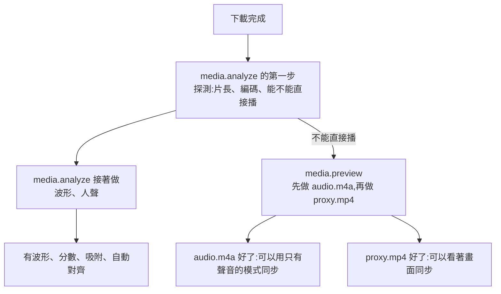

# 08 影片處理（media）

`media` 程式執行所有用到 ffmpeg 和 ffsubsync 的背景工作。這份文件裡的每一道指令都在 ffmpeg 6.1.1 和 ffsubsync 0.5.1 上實際跑過；可以直接執行的版本在 `reference/pipeline/`。

## 一部片下載完成之後



`torrent` 建立 `media_files` 之後 `NOTIFY paiban_media`。`media` 的對帳步驟看到這一列，替它排入工作（規則在下面的「對帳」）。每個下載完成的檔案都會先被探測；預覽資產不用等波形和人聲做完，探測一結束就可以開始轉。

## 實測數字

2 核心的沙盒環境，一部 2 小時的合成影片（單聲道 AAC、640×360）。真實的 1080p 影片在分析這幾步的耗時相近，因為只解碼聲音。

| 工作 | 耗時 | 產出大小 |
| --- | --- | --- |
| 波形（`peaks.bin`） | 12 秒 | 720 KB（gzip 後 310 KB） |
| 人聲偵測（`ref.npz`） | 23 到 27 秒 | 18 KB |
| 聲音檔，串流複製 | 4 秒 | 和原本的聲音軌一樣大 |
| 聲音檔，轉成立體聲 AAC 96 kbps | 3 分 43 秒 | 81 MB |
| 預覽檔 480p（來源是 1080p 10-bit HEVC、5.1 聲道） | 即時速度的 3.1 倍 | 每分鐘 2.6 MB |
| 預覽檔 720p（同上） | 即時速度的 2.4 倍 | 每分鐘 5.3 MB |
| 自動對齊一條字幕（人聲已快取） | ffsubsync 兩次共 0.7 秒；對齊核心 26 句 0.08 秒、180 句 0.4 秒（1,500 句估計約 3 秒，沒有實測） | |
| 封裝 MKV | 取決於磁碟速度；92 秒的片段 0.1 秒 | 和原檔差不多 |

預覽檔的速度是用 60 秒的片段量的。**2160p 的來源會慢很多，在 NAS 等級的 CPU 上可能比即時還慢**，這正是需要「只有聲音的模式」的原因。

## 分析（`media.analyze`）

輸入是 `media_files` 的一列。參考：`reference/pipeline/analyze.sh`。一個工作，兩個部分：

- **探測**：`probe_state` 是 `pending` 就做。每個檔案都會做一次，不到一秒。它決定這個檔案能不能直接播、片長多少、預覽資產的計畫要不要修正。
- **波形和人聲**：探測成功、而且 `analysis_state` 是 `pending` 才做。自動分析關掉（`media.analyzeAuto`）時，下載完成後是 `none`，這一部分要等到有人開啟這部片的工作區、前端呼叫 `POST /api/media/:id/analyze` 才做。

兩個部分各有自己的狀態，各自認領（`pending` → `running`）、各自結束。`POST /api/media/:id/analyze` 把 `none` 或 `failed` 的 `analysis_state` 設成 `pending`；`probe_state` 是 `failed` 時也一併設回 `pending`，再探測一次。

### 1. 探測

```bash
ffprobe -v error -show_format -show_streams -of json "$SRC" > probe.json
```

寫回 `media_files`：片長、容器、影像編碼、像素格式、寬高、影格率、聲音編碼、聲道數。

**能不能直接播**在這裡定案，取代下載前的預測：

```
direct_play =
     容器是 MP4
     && 影像是 h264 且像素格式是 yuv420p(8-bit 4:2:0)
     && (沒有聲音軌 || 第一條聲音軌是 aac 或 mp3)
  || 容器是 WebM
     && 影像是 vp8、vp9 或 av1 且像素格式是 yuv420p
     && (沒有聲音軌 || 第一條聲音軌是 opus 或 vorbis)
```

- ffprobe 對 MP4 回的 `format_name` 是 `mov,mp4,m4a,3gp,3g2,mj2`。對 MKV 和 WebM 回的是同一個值（`matroska,webm`），所以 WebM 要另外看副檔名是不是 `.webm`。MKV 一律不算能直接播。
- WebM 這一條主要是為了測試：端對端測試用 `fixtures/clip.webm`，這樣不依賴測試用的瀏覽器能不能解 H.264（交接時的 Playwright Chromium 不能；階段 0 用的 Playwright 1.63 可以，見 15-testing.md）。YTS 不發 WebM，正式環境幾乎遇不到。
- 判定寫成一個函式，之後要調整（例如某些瀏覽器播不了 5.1 聲道的 AAC）只改一個地方。

預測和實際不同時：

| 預測 | 實際 | 處理 |
| --- | --- | --- |
| 不能播 | 能播 | `audio_state`、`proxy_state` 改成 `none`，`reserve_bytes` 歸零 |
| 能播 | 不能播 | 之前沒有預留，也沒有預覽計畫，所以依**現在**的設定算。在交易裡 `storage_admit(預覽預留)`：通過就把 `audio_state`（和 `proxy_state`，如果自動轉檔有開）設成 `pending` 並寫入預留量；不通過就維持 `none`，`error.proxy` 記 `PREVIEW_NO_SPACE`，工作台會說明「下載完成時空間不足，沒有產生預覽檔。」並給「轉預覽檔」的按鈕 |

拿到實際片長後，用它重算預留量（下載前用的是 YTS 的片長，可能是 0）：

- 變少：直接改小。
- 變多：差額再過一次 admission。通過就調高。不通過就**放棄預覽影片**：`proxy_state = 'none'`、`error` 記 `PREVIEW_NO_SPACE`，預留量改成只有聲音檔的量；聲音檔照做。聲音檔很小，這裡不再另外檢查，道理和 [10-storage.md](10-storage.md) 的「小檔案」相同。

特殊情況：

| 情況 | 處理 |
| --- | --- |
| 沒有聲音軌 | 波形和人聲都做不出來：`analysis_state = 'failed'`，`error.analysis` 記 `NO_AUDIO`。聲音檔不做（`audio_state = 'none'`，那一部分的預留釋出）。預覽影片照做，只是沒有聲音。電影仍然可以進工作區，只是沒有波形、分數和自動對齊 |
| ffprobe 讀不了這個檔案 | `probe_state = 'failed'`，`error.analysis` 記 `PROBE_FAILED`。等著做的分析也標成 `failed`；預覽資產放棄（`none`，預留釋出）。檔案很可能是壞的，介面上要看得到這個原因。它不會自動再試；有人按「重新分析」或「轉預覽檔」才會 |

探測成功：`probe_state = 'ready'`，其他欄位寫回資料庫，`NOTIFY paiban_media`（預覽資產可以排入了）和 `paiban_events`（`torrent`；預留量有變就再加 `usage`）。

### 2. 波形

```bash
ffmpeg -v error -nostdin -i "$SRC" -map 0:a:0 -vn -ac 1 -ar 8000 -f s16le - \
  | node peaks.mjs 50 peaks.bin
```

`peaks.bin` 的格式：有號 8 位元整數，兩個一組（最小值、最大值），每秒 50 組。第 p 組涵蓋 `[p/50, (p+1)/50)` 秒。瀏覽器整個抓下來當 `Int8Array` 用。產生它的程式是 `reference/pipeline/peaks.mjs`，正式版把同樣的邏輯寫在 `media` 裡，直接讀 ffmpeg 的 stdout。

### 3. 人聲偵測

```bash
ln -s "$SRC" "$WORK/ref.mp4"                 # $WORK 是這個工作自己的暫存資料夾
ffsubsync "$WORK/ref.mp4" --serialize-speech --vad webrtc < /dev/null
mv "$WORK/ref.npz" "$OUT/ref.npz"            # $OUT 是 /data/media/<id>
```

三個一定要照做的細節，都是實測出來的：

- **`--vad webrtc` 不能省。** 預設值是 `subs_then_webrtc`：影片檔裡如果有內嵌的字幕軌，ffsubsync 會拿那條字幕的時間當作「人聲」，而不是分析聲音。用一個內嵌了錯誤字幕的檔案測試，結果有 46% 的影格和真正的人聲不同。
- **輸出位置由參考檔的路徑決定**：它寫在「參考檔路徑去掉副檔名 + `.npz`」。所以在工作的暫存資料夾裡建一個指向原檔的符號連結，用連結當參考檔，快取就落在暫存資料夾裡，再搬到輸出資料夾。下載資料夾保持原樣；唯一會被清掉的是這個工作自己的暫存。連結的副檔名要和原檔相同。
- **不給字幕也能跑**：不帶 `-i`、stdin 接 `/dev/null`，它做完人聲偵測就結束。

`ref.npz` 裡是一個叫 `speech` 的陣列，每 10 毫秒一個值（0 或 1）。之後對齊時把這個檔案當參考檔，就不用再分析聲音。

### 4. 給瀏覽器的人聲資料

```bash
python npz_to_speech_json.py ref.npz speech.json
```

`{"hz": 100, "frames": N, "segments": [[開始影格, 結束影格), …]}`。這就是 API 的 `SpeechData`，也是對齊核心的輸入。

### 分析結束

| 結果 | 狀態 |
| --- | --- |
| 波形和人聲都做出來了 | `analysis_state = 'ready'` |
| 其中一樣做不出來（兩次嘗試都失敗） | `analysis_state = 'failed'`，`error` 記 `PEAKS_FAILED` 或 `SPEECH_FAILED` |

失敗時，已經做出來的那個檔案留著照用：只有波形沒有人聲時，工作台有波形，但沒有分數、吸附和自動對齊。兩個端點（`peaks`、`speech`）各自看檔案在不在。

寫入 `analysis_bytes`，`NOTIFY`（`torrent`、`usage`）。畫面上的「分析中」變成「完成」。「下載完成」的通知不在這裡發：它在下載完成的那一刻就由 `torrent` 發了，不管分析成不成功。

## 預覽資產（`media.preview`）

只有不能直接播的版本才做。一個工作依序做兩樣，做不做看那一列的狀態：

1. `audio_state = 'pending'`：做聲音檔 `audio.m4a`。
2. `proxy_state = 'pending'`：做預覽影片 `proxy.mp4`，解析度是 `proxy_res`。

先做聲音檔是因為它快：影像還在轉檔時，使用者已經可以聽著聲音、看著波形對字幕（「只有聲音的模式」）。每做完一樣就寫入實際大小、重算 `reserve_bytes`、`NOTIFY`（`torrent`、`usage`），不用等另一樣。

參考：`reference/pipeline/preview.sh`。

### 聲音檔

| 來源的第一條聲音軌 | 做法 |
| --- | --- |
| AAC、1 或 2 聲道、位元率不超過 128 kbps | 串流複製（幾秒） |
| 其他（5.1、其他編碼） | 轉成立體聲 AAC 96 kbps（2 小時的片約 4 分鐘） |
| 沒有聲音軌 | 不做（探測時就已經把 `audio_state` 設成 `none`） |

```bash
# 轉檔的情況
ffmpeg -v error -nostdin -y -i "$SRC" -map 0:a:0 -vn -ac 2 -c:a aac -b:a 96k \
  -movflags +faststart -f mp4 audio.m4a.part && mv audio.m4a.part audio.m4a
```

### 預覽影片

```bash
ffmpeg -v error -nostdin -y -progress pipe:1 -nostats -i "$SRC" -map 0:V:0 -map 0:a:0? \
  -vf "scale=-2:'min(480,ih)':flags=bicubic,format=yuv420p" \
  -c:v libx264 -preset veryfast -crf 28 -maxrate 600k -bufsize 1200k -fps_mode passthrough \
  -c:a aac -ac 2 -b:a 96k -movflags +faststart -f mp4 proxy.mp4.part && mv proxy.mp4.part proxy.mp4
```

720p 時 `min(720,ih)`、`-maxrate 1500k -bufsize 3000k`。

- **`-fps_mode passthrough` 是重點。** 它讓每一格的時間戳和原檔完全相同。實測：1,439 格的時間戳清單，原檔和預覽檔的雜湊一模一樣。所以在預覽檔上對出來的時間，就是原檔的時間。
- **`-maxrate` 讓大小有上限。** 檔案不會超過「（影像上限 + 聲音 96 kbps）× 片長」，這就是下載前預留空間的依據（數字在 [10-storage.md](10-storage.md)）。完成後改記實際大小，通常只有上限的一半。
- **`min(480,ih)`：不放大。** 來源比目標小時維持原本的高度。
- **`0:V:0`（大寫）** 是第一條真正的影像軌，不會選到封面圖。**`0:a:0?`** 的問號表示「有就用」：來源沒有聲音軌時，預覽影片照樣做得出來，只是沒有聲音。
- 進度：`-progress pipe:1` 會輸出 `out_time_us=<微秒>`，除以片長就是進度，每 2 秒寫一次 `proxy_progress`。
- 用 `nice -n 10` 跑，讓網站和下載優先。

### 做完、失敗、被刪掉

- 把狀態改成 `ready` 的那個更新要帶條件（`where … = 'running'`）。改不到，表示這個資產在轉的途中被人刪掉了：把剛改名的檔案刪掉（那是這個工作自己的產物），結束。
- 失敗（兩次嘗試都失敗之後）：刪掉 `.part`，那個資產的狀態 `failed`，`error` 記 `TRANSCODE_FAILED`，釋出它的預留量。兩樣資產互不影響：預覽影片失敗時聲音檔照用，使用者仍然可以用只有聲音的模式。
- 管理員刪除預覽檔（[10-storage.md](10-storage.md)）：`api` 把兩個狀態設成 `none`、大小和預留歸零、刪掉檔案。正在轉的工作在下一次檢查時（2 秒內）發現自己那個資產不再是 `running`，就終止 ffmpeg、刪掉自己的 `.part`、結束。

### 事後要求

`POST /api/media/:id/proxy`：使用者在工作台按「轉預覽檔」（自動轉檔關掉、之前空間不足、失敗過、或被管理員刪掉之後）。它把聲音檔和預覽影片當中是 `none` 或 `failed` 的都設成 `pending`，預覽影片的解析度用現在的設定，兩者的預留量加起來過一次 admission。通過後清掉 `error`，`NOTIFY paiban_media`。探測失敗過（`probe_state` 是 `failed`）的檔案，同時把 `probe_state` 設回 `pending`：預覽資產要等探測成功才會開始，不這樣做它們會一直停在等待中。需要多少空間寫在 `MediaStatus.previewNeedBytes`，按鈕旁邊要顯示。

## 自動對齊

輸入：一條字幕或候選的句子清單，加上這部片的 `ref.npz` 和 `speech.json`。輸出：`AlignResult`。可以直接執行的參考實作是 `reference/pipeline/align.ts`。

同一套計算在兩個地方用：

| 佇列 | 什麼時候 | 結果去哪裡 |
| --- | --- | --- |
| `subtitle.align` | 使用者在工作台按「自動對齊」。他在等 | 寫進 `tasks.result`，由 `api` 回給瀏覽器 |
| `subtitle.rank` | 「全部自動對齊並排名」，一條候選一個工作 | 寫回那條候選的 `align_score` 和 `align_result` |

分成兩個佇列，是為了讓使用者按下去的那一次不用排在三十條候選後面。

### 為什麼用兩種方法

| 方法 | 長處 | 短處 |
| --- | --- | --- |
| ffsubsync | 很多人在真實影片上用過；分段模式能找出多個斷點 | 分段模式在字幕停留得比台詞久時，會整體偏早約 0.3 秒（實測）；結果只印到小數三位 |
| 對齊核心（`packages/shared` 裡的 `autoAlign`） | 和工作台用同一套計分；在合成素材上三種情境都在 60 毫秒內 | 只找一個斷點；搜尋範圍以外的落差找不到；沒有在真實影片上驗證過 |

兩者都只在合成語音上測過。讓它們各算一次、用同一把尺比較、並告訴使用者兩邊是否一致，是目前能給的最好的信心指標。

### 步驟

```
1. 寫一份暫存 SRT:時間照原樣,文字換成 "#<句子編號>"。
   (ffsubsync 只需要時間;這樣輸出能用編號對回去,字幕內容也不會進它的 log。)

2. ffsubsync ref.npz -i in.srt -o linear.srt --max-offset-seconds 60
   → 用最小平方法從「輸入的開始時間 → 輸出的開始時間」求出速率和位移   fitLinearSegment
   → 速率和某個已知比例差不到 0.002 就取那個比例                      snapScale
   → 在 ±1.5 秒內依人聲重新對正位移                                   refineSegments

3. 允許分段時:
   ffsubsync ref.npz -i in.srt -o split.srt --max-offset-seconds 60 --split-penalty
   → 相鄰兩句的斜率取中位數當速率,每句的位移相近的連成一段            fitPiecewise
   → 每一段各自重新對正                                               refineSegments

4. 對齊核心:autoAlign(speech, cues, { allowSplit, radius: 60 })

5. 用同一個目標函數給每個候選打分,每多一段扣 3 秒的台詞;              pickAlignment
   差距在 0.3 秒台詞以內時,取段數少的,再取比較常見的速率。

6. agree = 另一種方法的結果,每一句的開始時間都和選中的差不到 0.15 秒。
```

括號右邊是 `packages/shared/src/sync-core/core.ts` 裡對應的函式，全部有測試。

任何一次 ffsubsync 失敗（結束碼不是 0、沒有輸出、輸出的句數對不上、超過 20 秒）就略過那個候選，只要還有一個候選就照常回傳。兩種方法都失敗才算工作失敗。ffsubsync 正常不到 1 秒，20 秒已經很寬；對齊核心的時間可以預期（見「效能」），不另外設逾時。

### 結果怎麼回到 `api`

`POST /api/subtitles/:id/auto-align` 要等結果才回應，而計算在另一個程式裡：

1. `api` 建立一列 `tasks`（種類 `align`，`input` 是字幕的 id 和 `allowSplit`），排入 `subtitle.align`，然後等 `paiban_events` 上這個工作的通知（`{type: 'task', id}`）。
2. `media` 做完，把 `AlignResult` 寫進 `tasks.result`、`state` 改成 `done`（或 `failed`），`NOTIFY`。
3. `api` 讀出結果，回給瀏覽器。工作是 `failed`，或 60 秒內沒有等到通知，回 `ALIGN_FAILED`。等不到的時候，`api` 把那一列 `tasks` 標成 `failed`（`TIMEOUT`）；`media` 之後就算做完，它帶條件的更新也改不到，結果直接丟掉。

這個工作不自動重試：使用者再按一次就好。`tasks.input` 只放 id 和選項，句子清單由 `media` 自己從 `cues.json` 讀。

### 在測試素材上的結果

`fixtures/` 的 92 秒片段，三份故意弄錯的字幕（26 句）：

| 情境 | ffsubsync 單一位移 | ffsubsync 分段（原始） | 分段後重新對正 | 對齊核心 | 最後選中 |
| --- | --- | --- | --- | --- | --- |
| 整體晚 2.4 秒 | 最大誤差 54 ms | 250 ms（全部偏早） | 40 ms | 40 ms | 一段，×1，−2.36 秒 |
| 影格率不同（25 → 23.976） | 50 ms | 247 ms | 43 ms | 44 ms | 一段，×1.04271，−0.79 秒 |
| 剪輯版本不同（中間差 12 秒） | 12 秒（一個位移不可能對） | 254 ms，兩段 | 48 ms | 50 ms | 兩段，+1.25 / +13.24 秒 |

三種情境兩種方法都一致（`agree = true`）。前兩欄的原始數字在 `fixtures/expected.ffsubsync.json`，ffsubsync 的輸出檔在 `fixtures/ffsubsync/`，所以解析和比較的程式不用裝 ffsubsync 也能做單元測試。

`reference/pipeline/align.ts` 印出來的是最後一欄（分段、速率、位移）加上分數和 `agree`，不是每一種方法各自的誤差。拿它驗證環境時，比對的是最後一欄：段數和速率相同，位移相差在 0.01 秒以內，`agree` 是 true。中間幾欄的誤差是 `packages/shared/src/sync-core/core.test.ts` 在測的。

`fixtures/film/film.json` 是一部 21.5 分鐘的合成影片（180 句）。對齊核心在三種情境都是 180 句全部落在 100 毫秒內；剪輯不同的那一種，落差是 40 秒，搜尋範圍 30 秒時找不到、60 秒時找得到。所以範圍定為 60 秒，和 ffsubsync 的預設上限相同。

**92 秒的片段太短，分不出相近的速率**（例如 ×0.999 和 ×1）：兩者在片尾只差 0.09 秒。真實影片長度下差距是好幾秒，不會混淆。測試裡用「常見的速率優先」來處理這個平手。

### 效能

對齊核心的成本是「速率數 × 句數 × 位移格數」。1,500 句、範圍 60 秒、解析度 10 毫秒、7 種速率，約 1.3 億次查表，估計 3 秒；允許分段時每種速率要保留一張「句數 × 位移格數」的表，約 72 MB。在伺服器上可以接受。需要更快時先用 40 毫秒的解析度粗找，再在最佳位置附近用 10 毫秒細找。

**瀏覽器裡不跑整片的 `autoAlign`。** 瀏覽器只用到 `bestLinear`（吸附，範圍 1.5 秒）、`fitAnchors`、`applyDoc`、分數，這些都是毫秒等級。

### 對齊分數

`totalScore`：所有句子顯示的時間裡，有多少比例落在偵測到的人聲上，0 到 1。

- **對得很準的字幕也不會是 100%。** 測試片段的正確字幕是 80%，因為字幕會比台詞早一點出現、晚一點消失。
- 介面上的顏色門檻（70% 以上綠、55% 以上黃、以下紅；單句是 50% 和 25%）來自原型，**沒有在真實影片上校正過**。有配樂和音效的片，人聲偵測會把一些非人聲算進去，分數的絕對值會不同。門檻寫成共用常數，之後好調。
- 分數是用來比較「同一部片的不同字幕」和「調整前後」的，不是絕對的品質指標。介面上的說明文字是：「字幕與人聲重疊的比例，只是輔助，最後以耳朵為準」。

## 封裝（`export.mux`）

### 建立匯出時（`api`）

1. 驗證：每條字幕都是已確認的；恰好一條是預設軌；檔名合法。
2. 估計大小：`media_files.size_bytes × 1.01 + 1 MB`（就是 `Workspace.exportNeedBytes`）。在交易裡 `storage_admit`。
3. 通過後，**當場**把每條字幕套用同步文件並寫成最終的 SRT：`applyDoc` → `toSrt`，存在 `/data/exports/<id>/tracks/<n>.srt`（UTF-8）。這樣之後字幕被修改或刪除都不影響這次匯出。
4. 建立 `exports`（`queued`）和 `tasks` 的列，`NOTIFY paiban_media`。更新這部片的 `last_used_at`。

`toSrt` 的規則：刪除的句子不輸出、負的時間夾到 0、每句至少 0.2 秒、依開始時間排序、從 1 重新編號。

### 工作本身（`media`）

```bash
ffmpeg -v error -nostdin -y -progress pipe:1 -nostats \
  -i "$SRC" -i tracks/0.srt -i tracks/1.srt \
  -map 0:V -map 0:a? -map 1:0 -map 2:0 -c copy \
  -metadata title="片名 (年份)" \
  -metadata:s:s:0 language=chi -metadata:s:s:0 title="繁體中文" -disposition:s:0 default \
  -metadata:s:s:1 language=eng -metadata:s:s:1 title="English"  -disposition:s:1 0 \
  -f matroska "$OUT.part" && mv "$OUT.part" "$OUT"
```

每個選項的理由，都是實測過的：

| 選項 | 理由 |
| --- | --- |
| `-c copy` | 影像和聲音的封包雜湊和原檔完全相同，畫質不變，速度只受磁碟限制 |
| `-map 0:V`（大寫） | 只取真正的影像軌。小寫的 `0:v` 會把封面圖也當成第二條影像軌封進去 |
| `-map 0:a?` | 全部聲音軌；問號讓沒有聲音軌的來源也能封裝 |
| 不映射原檔的字幕軌 | 原檔內嵌的字幕不帶過去，MKV 裡只有使用者確認過的 |
| `-metadata title=` | 下載來的檔案，容器標題常是廣告字串 |
| 預設軌排第一個並設 `default` | 播放器會自動顯示它 |
| `.part` 再改名 | 看得到正式檔名的檔案一定是完整的 |

語言標籤：

| 字幕的語言 | `language` | `title` |
| --- | --- | --- |
| `zh-Hant`、`zh` | `chi` | 繁體中文 |
| `zh-Hans` | `chi` | 简体中文 |
| `en` | `eng` | English |
| 其他 | `und` | 原本的語言代碼 |

ffmpeg 只能寫三個字母的語言碼，所以繁簡靠 `title` 區分。這幾個標題是寫進檔案裡的固定字串，不是介面文案。

**時間**：原檔的聲音常有一點負的起始時間（AAC 的編碼延遲）。封裝成 MKV 時 ffmpeg 會把**所有**軌一起往後挪同樣的量（測試片段是 46 毫秒），字幕也一起挪，所以影像、聲音、字幕之間的相對時間不變。不需要、也不應該自己去補這個量。

**做完之後檢查一次**：用 ffprobe 看輸出檔，影像軌數、聲音軌數要和原檔相同，字幕軌數要等於要求的數量。不對就當成失敗（`VERIFY_FAILED`）。

### 結束的四種情況

| 情況 | 處理 |
| --- | --- |
| 電影在途中被移除 | `torrent` 在刪除的交易裡把這筆匯出標成 `failed`（`SOURCE_MISSING`）、預留歸零、通知建立者。封裝工作在下一次檢查時發現自己那一列不再是 `running`：終止 ffmpeg，刪掉 `.part` 和 `tracks/`。不會再試 |
| 完成 | `state = 'done'`、寫入實際的 `size_bytes`、`reserved_bytes` 歸零、刪掉 `tracks/`、通知建立者（`export.completed`） |
| 失敗（兩次嘗試都失敗之後） | 刪掉 `.part` 和 `tracks/`，`state = 'failed'`、`error_code`、`reserved_bytes` 歸零，通知建立者（`export.failed`）。第一次失敗時 `tracks/` 和預留量都留著，給第二次嘗試用 |
| 被取消（`cancel_requested`） | 終止 ffmpeg，刪掉 `.part` 和 `tracks/`，刪掉 `exports` 那一列 |

失敗的代碼（`ExportErrorCode`）：

| 代碼 | 意思 |
| --- | --- |
| `SOURCE_MISSING` | 來源的影片檔不見了，或這部電影在封裝途中被刪除 |
| `MUX_FAILED` | ffmpeg 失敗 |
| `VERIFY_FAILED` | 做完之後的檢查沒過 |
| `DISK_FULL` | 磁碟寫滿了 |

失敗的匯出留在清單上讓人看到原因，使用者可以刪掉它，或直接重新建立一個。它不能「重試」：當初暫存的字幕軌已經清掉，字幕也可能在那之後改過。

## 工作的共通規矩

- **看得到的工作在 `tasks` 有一列**：分析、預覽資產、對齊、排名、匯出、重新計算。開始、進度、結束都更新它，並 `NOTIFY`（`task`）。誰建立這一列，見下面的表。
- **先認領。** 處理函式一開始用帶條件的更新，把對應的列從「等待中」改成「進行中」（同時確認那個下載的 `want` 不是 `remove`）。改不到就直接結束：這件事已經有人在做，或已經不需要了。
- **執行中每 2 秒確認一次**：對應的列還在、狀態還是「進行中」、那個下載的 `want` 不是 `remove`、匯出的 `cancel_requested` 不是 true。不成立就終止子程序、清掉自己的半成品、把自己那一列 `tasks` 標成 `cancelled`（還沒被標的話）、結束。
- **寫出檔案前再確認一次。** 建立資料夾、把 `.part` 改名之前再看一次同樣的條件。
- **做完的那一筆更新要帶條件。** 把狀態改成完成時，條件寫在同一個敘述裡：那一列還在、狀態還是它認領時的「進行中」、那個下載的 `want` 不是 `remove`。改不到就表示東西在途中被刪了、正在被刪、或被取消了：把自己剛寫出來的檔案刪掉（它建立的資料夾空了也一併刪掉），結束。這一條讓「刪除」不需要等任何工作停下來（[03-data-model.md](03-data-model.md)）。
- 子程序一律用陣列形式的參數啟動，不經過 shell。檔案路徑都來自資料庫，不來自請求。
- 大的產出（預覽影片、聲音檔、匯出檔）先寫 `.part`，完成才改名。字幕和候選的小檔案在工作目錄裡備好再整個資料夾搬過去（[02-architecture.md](02-architecture.md) 的「磁碟配置」）。
- **失敗的工作自動再試一次，總共兩次。** 第一次失敗：清掉自己的半成品，那一列回到「等待中」，預留量和 `tracks/` 都不動；同一列 `tasks` 也回到 `queued`，`attempts` 加 1。下一次對帳會把它重新排進去。第二次也失敗（`attempts` 已經是 1）才算真的失敗：狀態改成 `failed`、記下錯誤代碼、釋出預留量。程式被重啟不算失敗，不加 `attempts`。這個計數是一列 `tasks` 一個：預覽資產的工作不管是聲音檔還是預覽影片失敗，都是整個工作再試一次（已經做好的那一樣不會重做）。
- **不自動再試的：**
  - 前景的對齊（`subtitle.align`）、字幕的查詢和抓檔：使用者自己再按一次比較快。
  - 排名裡的一條候選（`subtitle.rank`）：失敗就記成失敗，排名繼續做下一條。
  - 探測的結果是「讀不了」（`PROBE_FAILED`）或「沒有聲音軌」（`NO_AUDIO`）：再試也一樣，直接記下來。只需要探測的工作沒有 `tasks` 的列，也就沒有計數；它失敗一次就是失敗。
  - 來源的電影已經不在的匯出（`SOURCE_MISSING`）。
- **`media` 程式啟動時**：清空 `/data/tmp/work`；刪掉 `/data/media` 和 `/data/exports` 底下殘留的 `*.part`（那是上次沒寫完的半成品，不是任何人的檔案）；把停在「進行中」的東西改回「等待中」（下一節的表）；做一次對帳。

### 誰建立 `tasks` 的列

| 種類 | 誰、什麼時候 | `subject` |
| --- | --- | --- |
| `analyze`、`preview` | `media`，在對帳時替那一列排入工作的同時 | 片名、版本 |
| `export` | `api`，建立匯出的時候 | 片名、檔名 |
| `align` | `api`，收到「自動對齊」的請求時 | 片名、字幕的語言 |
| `rank` | `api`，收到「全部自動對齊並排名」的請求時 | 片名 |
| `rescan` | `api`，收到「重新計算用量」的請求時 | （空） |

`input` 記下這個工作是對誰做的（影片、字幕、匯出的 id，或排名的那批候選），對帳和重試都靠它。

一列 `tasks` 變成 `cancelled` 的時機：它的對象被刪除或被取消了。電影被移除（`torrent` 在刪除的那個交易裡標；還沒做完的匯出是例外，它們的 `tasks` 標成 `failed`，見「結束的四種情況」）、預覽檔被管理員刪掉、匯出被取消或在排隊時被刪掉（`api` 標），或者工作自己發現對象不在了。

## 對帳

`media` 在三個時機做對帳：啟動時、收到 `NOTIFY paiban_media` 時、每 60 秒。正在被刪除的片（`want = 'remove'`）一律跳過。

**啟動時，先把上次停在半路的東西復原**（只在啟動時做一次，在第一次對帳之前）：

| 上次停在 | 改成 |
| --- | --- |
| `media_files` 的 `probe_state`、`analysis_state`、`audio_state`、`proxy_state` 是 `running` | `pending` |
| `exports.state = 'running'` | `queued` |
| `subtitle_candidates.align_state = 'running'` | `queued` |
| `tasks.state = 'running'`，種類是 `analyze`、`preview`、`export`、`rank`、`rescan` | `queued` |
| `tasks` 裡還沒結束的 `align` | `failed`：等它的那個請求早就不在了 |

**每次對帳做四件事：**

1. **替等待中的列排入工作。** 同一列已經有排隊中或進行中的工作就不再排。要建立 `tasks` 的那兩種，只在沒有還沒結束的同一種工作時才建立新的一列；有的話（第一次失敗之後回到 `queued` 的那一列）就沿用它。

   | 情況 | 排入 |
   | --- | --- |
   | `probe_state = 'pending'`；或 `probe_state = 'ready'` 而且 `analysis_state = 'pending'` | `media.analyze`。`analysis_state` 是 `pending` 時建立一列 `analyze` 的 `tasks`；只需要探測時不建立 |
   | `probe_state = 'ready'`，而且 `audio_state` 或 `proxy_state` 是 `pending` | `media.preview`，建立一列 `preview` 的 `tasks` |
   | `exports.state = 'queued'` | `export.mux` |
   | `rescan` 的 `tasks` 是 `queued` | `storage.rescan` |
   | 還沒結束的排名裡，檔案已經抓好（`fetch_state = 'ready'`）而 `align_state = 'queued'` 的候選 | `subtitle.rank` |

2. **結算排名。** 每一個還沒結束的 `rank`：看它那一批候選裡**現在還存在的**，數有結果的（`align_state` 是 `done` 或 `failed`，或 `fetch_state` 是 `failed`），更新進度；還存在的都有結果就標成 `done`。途中被使用者移除、或被新的搜尋結果取代的候選不算在內，否則排名會永遠等一條已經不存在的候選。`subtitle.rank` 的工作每做完一條候選也呼叫同一段邏輯，所以進度是即時的；移除候選和重新搜尋也會 `NOTIFY paiban_media`；對帳本身只是保底。

3. **處理卡住的候選。** `fetch_state = 'fetching'` 超過 10 分鐘的，改成 `failed`（`DOWNLOAD_FAILED`）；它如果在等排名，`align_state` 也改成 `failed`。

4. **收掉沒有對象的工作。** `tasks` 還沒結束、但它的對象已經不存在的，標成 `cancelled`。

對帳本身不刪任何檔案，也不依時間刪任何東西；第 3 項改的是狀態，不是檔案。

## 手動重試

系統狀態頁上失敗的工作有「重試」（`POST /api/admin/tasks/:id/retry`）。它做的事依種類不同：

| 種類 | 重試做什麼 |
| --- | --- |
| `analyze` | 把 `analysis_state` 設回 `pending`，和 `POST /api/media/:id/analyze` 相同 |
| `preview` | 和 `POST /api/media/:id/proxy` 相同：失敗的資產設回 `pending`。預留量在失敗時已經釋出，所以**要重新通過 admission** |
| `rescan` | 再排一次 |
| `align`、`rank`、`export` | 不能重試（`Task.retryable` 是 false，介面不顯示按鈕）。對齊由使用者在工作台再按一次；排名在字幕分頁按「重新排名」；匯出重新建立一個 |

重試會產生一列新的 `tasks`；原本失敗的那一列留著當紀錄。分析和預覽資產的新工作是 `media` 在下一次對帳時建立的，所以端點回的是原本那一列（不變）；新的那一列隨 `admin` 事件出現在系統狀態頁。

## 還沒驗證的

| 項目 | 風險 |
| --- | --- |
| 真實電影的人聲偵測品質（配樂、音效、多人同時講話） | 分數和自動對齊的準確度都取決於它。階段 0 要用一部合法的真實影片試 |
| 兩種對齊方法在真實電影上的準確度 | 同上 |
| 分數門檻 | 見上 |
| 2160p HEVC 在目標機器上的轉檔速度 | 可能很慢。只影響預覽檔多久能用，不影響能不能同步 |
| YTS 的 MP4 能不能在瀏覽器直接播（`moov` 的位置、5.1 聲道的 AAC） | 不能的話那些檔案也要走預覽檔。階段 0 第 7 項用開放電影做出來的類似檔案確認；真的 YTS 檔案要等 Brian 實際使用時才會遇到 |
| 用 `mkvpropedit` 補上 BCP 47 語言標籤（`zh-TW`） | 沒試過，列為可選的改進 |
| pg-boss 12 的去重鍵、重試、並行設定的確切寫法 | 這份文件只描述需要的行為。做法以它的文件為準 |
